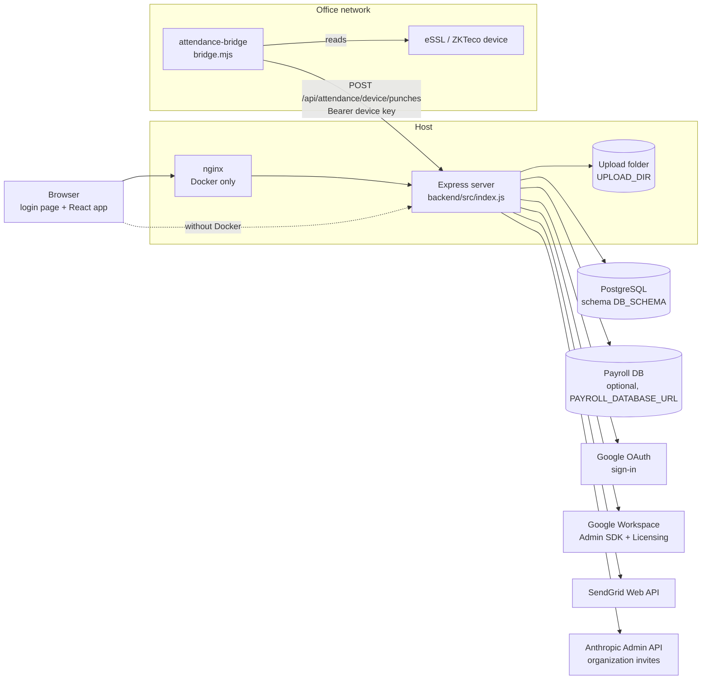

# Wohlig One — Architecture

> [!info] Read this first
> This is the map of the `hr-automation` repo, for people and LLMs. Read it before you open the code.
> The repo holds one Node server ([backend/](backend/)) and one React interface ([frontend/](frontend/)).
> There is no build step for the server and no ORM: routes run SQL directly through `pg`.
> The schema source of truth is [backend/src/schema.sql](backend/src/schema.sql), which the server applies on every start.
> Related docs: [[CLAUDE]] ([CLAUDE.md](CLAUDE.md), working rules) and [[BRAND_GUIDELINES]]
> ([docs/BRAND_GUIDELINES.md](docs/BRAND_GUIDELINES.md), Wohlig brand tokens). Read the brand file before any UI work.
> Also: [backend/docs/DEPLOY-CHECKLIST.md](backend/docs/DEPLOY-CHECKLIST.md), [backend/docs/PAYROLL.md](backend/docs/PAYROLL.md),
> [backend/attendance-bridge/README.md](backend/attendance-bridge/README.md).

## 1. Purpose

Wohlig One (formerly "HR Access Hub") is the staff portal for Wohlig (`@wohlig.com` accounts only). HR uses it to onboard and offboard people,
manage logins, approve leave, run payroll and review expense claims. Employees use it for their profile, documents, leave,
attendance, payslips, reimbursements, the company feed and their Digital Kit (signature, templates, greetings).

## 2. Tech stack

| Layer | What |
|---|---|
| Server | Node 22 (Docker image), ES modules, Express 4, `pg` 8, `dotenv` |
| Server libraries in use | `google-auth-library` (Workspace Admin SDK), `exceljs` (payroll Excel, tax import), `pdfkit` (payslip PDF), `@cantoo/pdf-lib` (locks uploaded documents as password PDFs) |
| Database | PostgreSQL (shared Cloud SQL in practice; `postgres:16` for the optional local container) |
| Interface | React 18, Vite 5, `react-router-dom` 6, Tailwind CSS 4 (`@tailwindcss/vite`) with the Wohlig theme in one stylesheet (older hand-written rules are being moved to Tailwind classes in stages), `radix-ui` for unstyled behaviour (dialog, dropdown menu, popover, tabs, tooltip); no styled UI kit, no state library |
| Email | SendGrid Web API over `fetch` |
| Office connector | Node 20+, `node-zklib`, Windows batch and VBS launchers |
| Tests | `node:test` plus two script-style flow tests |

`@anthropic-ai/sdk` and `nodemailer` are listed in [backend/package.json](backend/package.json) but no file imports them.

## 3. How it runs

### Local development

```
cd backend && cp .env.example .env    # fill in the values
npm install && npm run build:ui       # builds frontend/dist
npm run dev                           # node --watch src/index.js, http://localhost:3000
cd ../frontend && npm run dev         # optional: Vite on 5173, proxies /api, /auth, /invite to the server
```

Express serves everything on one origin: the API, `/login`, `/app/*` from `frontend/dist`, and the logos from `frontend/public`.
`frontend/dist` is committed, so the server works without a build.

### Docker

`docker compose up --build` gives `http://localhost:8080` ([docker-compose.yml](docker-compose.yml)).

| Service | Image | Job |
|---|---|---|
| `frontend` | [frontend/Dockerfile](frontend/Dockerfile), nginx 1.27 | Serves the built interface and `public/`; proxies `/api/`, `/auth/`, `/invite/`, `/l/`, `/p/` to the backend ([frontend/nginx.conf.template](frontend/nginx.conf.template)). Port 8080 to 80. |
| `backend` | [backend/Dockerfile](backend/Dockerfile), built from the repo root | The API on port 3000. Uploads live in the `hrhub-uploads` volume at `/srv/uploads`. |
| `db` | `postgres:16`, profile `local-db` only | A throwaway local database on 5432. |

In Docker, nginx decides who sees a page: it asks `GET /api/me` through `auth_request` and shows `/login` on a 401.

### Environment variable names

Values live in `backend/.env` (never committed). Names from [backend/.env.example](backend/.env.example):

- Core: `PORT`, `DATABASE_URL`, `DB_SCHEMA`, `SEED_ROSTER`, `BACKGROUND_JOBS`, `PUBLIC_URL`, `FRONTEND_URL`, `ALLOWED_EMAIL_DOMAIN`
- Speed: `DB_POOL_MAX` (database connections kept open, default 15), `DB_STATEMENT_TIMEOUT_MS` (longest one query may run, default 20000), `SLOW_REQUEST_MS` (log any /api request slower than this, default 400)
- Accounts: `DEFAULT_PASSWORD`, `HR_ADMIN_EMAIL`, `HR_LEAVE_APPROVERS`, `ALLOW_PASSWORD_LOGIN`, `GOOGLE_OAUTH_CLIENT_ID`, `GOOGLE_OAUTH_CLIENT_SECRET`
- Google Workspace: `GOOGLE_SERVICE_ACCOUNT_FILE`, `GOOGLE_ADMIN_EMAIL`, `GOOGLE_SKU_STARTER`, `GOOGLE_SKU_BUSINESS`, `GOOGLE_PRODUCT_ID`
- Email: `SENDGRID_API_KEY`, `SENDGRID_EU`, `MAIL_FROM`, `MAIL_SKIP_RECIPIENTS`
- Local safety: `LIVE_SERVICES_LOCAL` (a server on a local database sends no email, creates no Google accounts and sends no Claude invites unless this is `true`; see `live-services.js`)
- Reimbursements: `REIMB_REMINDER_DAYS`, `REIMB_NO_RECEIPT_MAX`, `OCR_PROVIDER`
- Claude access: `ANTHROPIC_ADMIN_KEY`, `ANTHROPIC_INVITE_ROLE`
- Attendance: `ATTENDANCE_DEVICE_KEY`, `PORTAL_ATTENDANCE_SYNC`, `PORTAL_ATTENDANCE_SYNC_SECONDS`, `WEB_CLOCK_IN` (true lets everyone punch in and
  out from the app; off by default, so the office machine stays the record)
- AI (LinkedIn headline ideas in the Digital Kit): `GEMINI_API_KEY`, `GEMINI_MODEL`
- Gmail Intelligence Engine (project emails to weekly report facts): `GMAIL_INTEL_ENABLED`, `GMAIL_COMPANY_DOMAIN`, `GMAIL_PUBSUB_TOPIC`, `GMAIL_PUSH_TOKEN`, `GMAIL_SYNC_MINUTES`, `ANTHROPIC_API_KEY` (a normal Claude key, separate from the admin key), `GMAIL_CLASSIFY_MODEL`, `GMAIL_EXTRACT_MODEL`, `GMAIL_PRICE_CLASSIFY`, `GMAIL_PRICE_EXTRACT`. It also reads `GOOGLE_SERVICE_ACCOUNT_FILE` and optional `OFFICE_LOCATION` (the work location saved when HR marks someone On-site, default Office)
- Salaries and documents: `SALARY_OWNERS` (the only people who see salaries, payslips, bank details, tax and finance reports; kailash@wohlig.com when empty), `DOCUMENTS_ENCRYPTION_KEY` (encrypts uploaded personal documents; `PAYROLL_ENCRYPTION_KEY` when empty).
- Payroll: `PAYROLL_DATABASE_URL`, `PAYROLL_DB_SCHEMA`, `PAYROLL_REVIEWERS`, `FINANCE_VIEWERS` (the accountant: finance reports only), `NOTICE_PERIOD_DAYS` (default notice, 30), `PAYROLL_ENCRYPTION_KEY`, `PAYROLL_DEBIT_ACCOUNT`, `PAYROLL_DEBIT_BANK_CODE`, `PAYSLIP_AUTO`.

The code also reads these, which the example file does not list: `UPLOAD_DIR`, `MAIL_REPLY_TO`, `EMAIL_LINK_MINUTES`,
`LEAVE_APPROVAL_LINK_HOURS`, `LEAVE_DIGEST_HOUR`, `LEAVE_DIGEST_SEND_EMPTY`, `LEAVE_DIGEST_EMAILS`, `LEAVE_HR_EMAILS`,
`CLAUDE_ADMIN_EMAILS`, `CLAUDE_REMIND_DAYS`, `PAYSLIP_AUTO_FROM`, `ANTHROPIC_API_URL` (test override).

The connector has its own file, [backend/attendance-bridge/.env.example](backend/attendance-bridge/.env.example):
`DEVICE_IP`, `DEVICE_PORT`, `DEVICE_NAME`, `APP_URL`, `DEVICE_KEY`, `INTERVAL_SECONDS`, `SYNC_FROM`.

Most integrations have a simulated mode when their settings are empty: Google Workspace, Claude access, email and device sync.

## 4. Runtime diagram



The Anthropic link is the Admin API called with `fetch` in [backend/src/anthropic.js](backend/src/anthropic.js): it invites
people to the Claude organization and removes them. The app does not call a Claude model anywhere.

## 5. Directory map

```
hr-automation/
├── docker-compose.yml          frontend (nginx) + backend + optional db
├── .claude/settings.json       shared Claude Code hooks: check this file, and check that interface changes were seen in a browser
├── .claude/hooks/              browser-check.mjs: the browser-check Stop hook
├── docs/                       BRAND_GUIDELINES.md and the brand PDF
├── backend/
│   ├── src/                    the server: index.js plus one file per feature
│   │   ├── index.js            app set-up and route mounts only (routes live in their own files)
│   │   ├── schema.sql          every table; applied on each start
│   │   └── payroll/            payroll workflow (routes, engine, tax, bank file, Excel, own schema.sql)
│   ├── migrations/hrhub-schema.sql   generated copy of schema.sql for a SQL console
│   ├── scripts/                one-off and operations scripts (migrate, imports, relay, check-architecture)
│   ├── seed/                   roster.json (first-run staff list) and digital-kit/ official files
│   ├── test/                   unit tests (*.test.mjs) and flow tests
│   ├── docs/                   DEPLOY-CHECKLIST.md, PAYROLL.md
│   └── attendance-bridge/      office connector for the attendance device (separate package)
└── frontend/
    ├── index.html, login.html  the two Vite entry pages
    ├── leave-rules.cjs         leave rules shared by server and browser
    ├── nginx.conf.template     nginx config for the Docker image
    ├── public/                 logos, favicons, sig/ icons; served at the site root
    ├── dist/                   committed build output
    └── src/                    App.jsx, pages/, modules/, components/, login/, lib/
```

## 6. Backend

### Layering

There are no controller, service or repository layers. Each feature file in [backend/src/](backend/src/) holds its routes,
its SQL and its helpers, and exports a router. [backend/src/index.js](backend/src/index.js) (about 110 lines) only wires
them together: middleware, the routers in order, start-up and the background jobs. [backend/src/db.js](backend/src/db.js) exports `pool`
(main database) and `payPool` (payroll database, the same pool unless `PAYROLL_DATABASE_URL` is set).

Mount order matters. `security.js` runs first (security headers, then the same-origin check on changes). The documents and
Digital Kit routers are mounted before `express.json()` because they read raw file bodies. `accountRouter` makes every
later `/api` route require sign-in. The pages router comes last. The JSON body limit is 100 kb. `trust proxy` is set from
`TRUST_PROXY` (default 1), so `req.ip` is the caller behind nginx or Cloud Run.

### Routers and modules

| File | Mount | Job |
|---|---|---|
| [users.js](backend/src/users.js) | `/api` (`sessionRouter`, `accountRouter`), `/api/users` | Password login (testing only), logout, invite acceptance, `/api/me`, HR user management |
| [google-signin.js](backend/src/google-signin.js) | `/auth` | Google OAuth code flow with PKCE |
| [onboarding-routes.js](backend/src/onboarding-routes.js) | `/api/onboarding/*`, `/api/work-email` (HR only) | New joiners: draft, work email, Google account, first login, final record. Candidate details include two emergency contacts (name, relation, number; the first required, neither the candidate's own number), saved onto the person's profile for the ID card |
| [id-card.js](backend/src/id-card.js) | `/api/id-card.pdf`, `/api/id-cards.pdf` | Staff ID cards as CR80 PDFs (85.6 × 54 mm, front and back; front: hexagon photo, employee code, mobile, blood group, date of joining, email; back: the card terms, the holder's own first emergency contact (number, with name and relation) from My profile > Contact details, and the company address from `company` in `brand.config.json`): own for everyone, anyone's in scope with `people.view`, all current staff for `people.view` company-wide |
| [people.js](backend/src/people.js) | `/api/directory`, `/api/roster`, `/api/managers`, `/api/employees/{manager,number,status}`, `/api/team/members` | Who is at the company, reporting lines, employee IDs. As in Keka, the reporting manager is required: `checkManager` refuses clearing it for anyone but the top of the company (`isTopTitle`: directors, the Vice President, the CEO). `moveTeam` moves a leaver's direct reports to a new manager (a team member who steps up reports to the leaver's own manager) |
| [projects.js](backend/src/projects.js) | `/api/allocations`, `/api/projects` | Projects and who works on them; handovers. HR and admins see every project; everyone else only the projects they are on or lead |
| [tool-access.js](backend/src/tool-access.js) | `/api/audit`, `/api/tool-access` | The audit log and Claude access |
| [pages.js](backend/src/pages.js) | `/`, `/login`, `/app/*`, `/auth`, `/invite`, `/l`, `/p`, `/sig`, logos, `/leave-rules.js` | The pages and public links; mounted last |
| [jobs.js](backend/src/jobs.js) | none (timers) | Every scheduled job; started unless `BACKGROUND_JOBS=off` |
| [security.js](backend/src/security.js) | every request | Security headers; refuses changes (POST, PUT, PATCH, DELETE) sent from another website |
| [limits.js](backend/src/limits.js) | none | Sign-in lockout and rate limits, kept in the `rate_limits` table |
| [invites.js](backend/src/invites.js) | `/invite` | One-time 30-minute invite links |
| [email-links.js](backend/src/email-links.js) | `/l` | Short-lived links used in automatic emails |
| [profile.js](backend/src/profile.js) | `/api/profile` | "My profile" sections and profile photo. Contact details hold two emergency contacts (name, relation, number): the first is required when the contact section is saved, the second is optional, neither may be the person's own number or the same as the other |
| [documents.js](backend/src/documents.js) | `/api/documents` | Personal document uploads; owns `UPLOAD_DIR`. Files are stored encrypted (names end in `.enc`); opening one needs the viewer's document password and is audited when it is someone else's. `encryptStoredDocuments` encrypts older plain files at start-up |
| [pdf-lock.js](backend/src/pdf-lock.js) | none (used by documents.js and engage.js) | Turns an uploaded PDF, JPG or PNG into a PDF locked with the viewer's document password (`@cantoo/pdf-lib`); a PDF its owner already locked is sent as it is. Every personal document, tax proof, payslip and Form 124 leaves this way (generated PDFs are drawn first, then locked), AES-256 |
| [file-crypt.js](backend/src/file-crypt.js) | none (used by documents.js) | AES-256-GCM for stored documents with `DOCUMENTS_ENCRYPTION_KEY` (or `PAYROLL_ENCRYPTION_KEY`); with neither, uploads are refused on the live server (`NODE_ENV=production`) and stored plain only in local development |
| [doc-password.js](backend/src/doc-password.js) | `/api/document-password` | Each person's document password (at least 10 characters): set it; change it with the current one, or, when forgotten, within 10 minutes of a new sign-in (`sessions.created_at`); unlock for 10 minutes in that sign-in only; lock. A scrypt hash in `document_passwords`; five wrong tries (counted before they are checked) lock it for 15 minutes; a change is audited and the person is told. Unlocks and tries are kept in the server's memory (one server process). `needDocUnlock` guards document files, tax proofs, Form 124, one payslip's figures and payslip PDFs (the payslip list leaves out net pay until then, `locked: true`), and every file sent out is a PDF locked with the password (`pdf-lock.js`) |
| [digital-kit.js](backend/src/digital-kit.js) | `/api/digital-kit` | Each person's kit; HR manages shared resources under `/admin` |
| [gemini.js](backend/src/gemini.js) | none | LinkedIn headline ideas from Gemini for the Digital Kit. Sends only designation, department and an optional note; cleans the replies |
| [holiday-import.js](backend/src/holiday-import.js) | none (used by leave.js) | Reads an Excel or CSV holiday list (any year) into holidays, compares it with the saved list, builds the template |
| [details-sheet.js](backend/src/details-sheet.js) | none (registered by onboarding-routes.js) | The routes of the employee details sheet (template, preview, save) for Onboarding |
| [payroll/master.js](backend/src/payroll/master.js) | none (registered by payroll/routes.js, under `/api/payroll/master`) | The payroll bank details: the one-person form (bank, branch, Aadhaar, PAN; opened by the Bank button on Salary & bank), the "Bank Details Format" Excel (No., Account Holder Name, Bank Name, Account Number, IFSC Code, Branch Name: one downloadable sheet listing everyone, bulk upload behind the View the sheet button on Salary & bank: the same sheet opens as a table you type into, each cell saves when you leave it and what is unsaved is saved on close; Download as Excel and Upload Excel are inside it, and an uploaded file that only adds details is saved as soon as it is read, one that would replace saved details waits for a confirmation), a paged list, and the audited reveal of a full number. Matches people by Employee Number, never creates employees, keeps the profile's masked numbers in step |
| [onboarding-import.js](backend/src/onboarding-import.js) | none (used by onboarding-routes.js) | The employee details sheet: builds the template (headings, optionally the people who still lack details), reads an uploaded sheet into cleaned and validated details per person, and describes what each row would add, masked |
| [leave.js](backend/src/leave.js) | absolute `/api/leave/*`, `/api/employees/:email/pay` | Leave requests, decisions, comp offs, holidays, salary cuts |
| [excel-preview.js](backend/src/excel-preview.js) | none (used by the three Excel exports) | Reads a generated workbook back into sheets, headings and rows, so `?preview=1` on an export shows exactly what the file holds |
| [id-numbers.js](backend/src/id-numbers.js) | none (used by people.js and documents.js) | Decrypts the full PAN and Aadhaar for the two Excel files HR downloads; falls back to the masked form where no full number is held |
| [employee-export.js](backend/src/employee-export.js) | none (used by people.js) | Builds the employee details workbook HR downloads from the Employees page |
| [documents-export.js](backend/src/documents-export.js) | none (used by documents.js) | Builds the documents workbook HR downloads from Onboarding > Documents: each document type as Uploaded or Missing per person, and a list of files |
| [leave-export.js](backend/src/leave-export.js) | none (used by leave.js) | Builds the company leave workbook HR downloads from Leave management (`leave.manage` or `leave.approve` for the whole company) |
| [leave-digest.js](backend/src/leave-digest.js) | `/api/leave/digest` | Daily "who is on leave" email to HR |
| [leave-mail.js](backend/src/leave-mail.js), [teams.js](backend/src/teams.js) | none | Leave emails; who approves whose leave |
| [attendance.js](backend/src/attendance.js), [clockin-rules.js](backend/src/clockin-rules.js) | `/api/attendance` | Today, month, day, report, manual punches; web clock-in with location (as Keka's geo-fencing), one tap and never a selfie: `POST /api/attendance/punch` takes the phone's location when HR asks for it and checks it against HR's offices (refused outside them, or kept and flagged when HR allows), `GET/PUT /api/attendance/clock-in` and `POST/PUT/DELETE /api/attendance/clock-in/sites` (`shifts.manage`). `security.js` allows location for the site itself only |
| [device.js](backend/src/device.js) | `/api/attendance/device/*` | Punch intake from the connector; linking device IDs to people |
| [portal-attendance.js](backend/src/portal-attendance.js) | none (timer) | Copies punches from the Employee Portal's table when enabled |
| [gmail-intel.js](backend/src/gmail-intel.js) | none (library) | Reads and filters project emails, asks Claude Haiku to sort them and Claude Sonnet to extract facts, validates every reply |
| [gmail-api.js](backend/src/gmail-api.js) | none (library) | Read-only Gmail through the service account's domain-wide delegation (`gmail.readonly` only) |
| [gmail-intel-routes.js](backend/src/gmail-intel-routes.js) | `/api/gmail-intel/*`, `/api/project-reports/*` | Mailbox list, sync, review queue and AI usage (HR); Pub/Sub push (token); weekly project reports with email (everyone sees their own projects, HR sees all) |
| [assets.js](backend/src/assets.js) | `/api/assets` | Company assets; IT admins and HR |
| [posts.js](backend/src/posts.js) | `/api/posts` | Company feed: posts, images, likes, comments, shares |
| [engage.js](backend/src/engage.js), [engage-rules.js](backend/src/engage-rules.js) | `/api/polls`, `/api/praise`, `/api/rewards`, `/api/articles`, `/api/apps`, `/api/requests/advance`, `/api/requests/attendance`, `/api/remote-today`, `/api/tax-declaration`, `/api/tax-declarations`, `/api/goals` | Polls (one vote each, totals only), praise between colleagues, rewards (`rewards.give` gives one from Users; people read their own on Praise > My rewards), HR articles, app links, and advance and attendance requests that HR approves or declines. The checking rules are in `engage-rules.js`, tested without a database |
| [hr-tools.js](backend/src/hr-tools.js), [hr-tools-rules.js](backend/src/hr-tools-rules.js) | `/api/hr/probations`, `/api/tickets`, `/api/hr/exit-interviews`, `/api/hr/openings`, `/api/hr/candidates`, `/api/reviews`, `/api/review-cycles`, `/api/feedback-requests`, `/api/interviews` | HR tools: probation decisions, the helpdesk, exit interviews, hiring and performance reviews. Probation, exit interviews and hiring are HR only; people see only their own tickets and reviews. Rules in `hr-tools-rules.js`, tested without a database |
| [hr-tools.js](backend/src/hr-tools.js), continued | `/api/review-cycles`, `/api/reviews/:id/manager`, `/api/reviews/:id/feedback-requests`, `/api/feedback-requests`, `/api/hr/candidates/:id/onboard`, `/api/hr/candidates/:id/interviews`, `/api/hr/interviews/:id/cancel`, `/api/interviews`, `/api/interviews/:id/verdict`, `/api/interviews/:id/calendar` | Review cycles for everyone or a department, calibration (`GET /api/review-cycles/:id/calibration`, `PUT /api/reviews/:id/calibrate`: HR moves a rating with the reason and sets potential for the 9-box; never your own, locked once finished, never shown to the person or the manager), the reporting manager's review between the self-review and HR, colleague feedback the person never sees, managers reading their team's goals (`/api/goals?email=`), a hired candidate copied into the HR user's onboarding draft, and interviews with each interviewer's recommendation and a calendar file (.ics) |
| [workforce.js](backend/src/workforce.js), [workforce-rules.js](backend/src/workforce-rules.js) | `/api/timesheet`, `/api/timesheets/to-approve`, `/api/timesheets/:id/decision`, `/api/surveys`, `/api/training`, `/api/trainings`, `/api/hr/resignations`, `/api/stand-ins` | Timesheets (a week per person, approved by the reporting manager, a stand-in covering them, or HR), surveys (named or anonymous; HR creates them and sees results), training (HR assigns, people mark done), notice periods (HR records resignations; expected last day = resigned on + notice days) and approval stand-ins (someone who decides leave for a manager while they are away). `workforce-rules.js` holds the checking rules, also for review cycles, colleague feedback and interviews (used by `hr-tools.js`), and timesheet minutes per project (used by `finance-reports.js`); tested without a database. Design: [docs/HR_GAPS_DESIGN.md](docs/HR_GAPS_DESIGN.md) |
| [finance-reports.js](backend/src/finance-reports.js), [finance-rules.js](backend/src/finance-rules.js) | `/api/finance/periods`, `/api/finance/statutory`, `/api/finance/journal`, `/api/finance/cost`, `/api/finance/gratuity`, `/api/finance/tax-statements`, `/api/finance/tax-statements/:email`, `/api/finance/files`, `/api/finance/tds-sheet`, `/api/finance/shares`, `/api/finance/contractors` | Open to HR, payroll reviewers and the accountant (`FINANCE_VIEWERS`, who see only this). Also: employer ESIC (3.25%, worked out in the report), labour welfare fund for Maharashtra in June and December, the PF return (ECR) text file, the ESIC contribution sheet, a Tally import file for the journal, a TDS sheet per quarter, project shares in per cent (HR sets them; `employee_project_allocations.share_percent`) and contractor payments with TDS (`contractor_payments`). Finance reports for the accountant, read from payroll that is already calculated: statutory dues (PF, ESIC, professional tax, TDS) with due dates, the month as one balanced journal entry, cost by department and project, a gratuity estimate, and the year's salary and TDS per person and per quarter. Open to HR and the payroll reviewers. Nothing here writes to payroll. `finance-rules.js` also checks HR's proof notes on tax declarations (`PUT /api/tax-declarations/:email/proofs` in engage.js) |
| [workforce.js](backend/src/workforce.js), [workforce-rules.js](backend/src/workforce-rules.js) | `/api/timesheet`, `/api/timesheets/to-approve`, `/api/timesheets/:id/decision`, `/api/surveys`, `/api/surveys/:id/answers`, `/api/surveys/:id/results`, `/api/training`, `/api/trainings`, `/api/hr/resignations`, `/api/stand-ins` | Timesheets (a week of hours per project; the reporting manager, a stand-in or HR approves; approved hours set cost by project), surveys (anonymous by default, results hidden below 3 answers, eNPS), training records, notice periods (resignation date plus notice days, short notice flagged) and approval stand-ins (cover a manager's leave approvals; `teams.js` `coveredBy`, used by `leave.js` and `leave-mail.js`). Design: [docs/HR_GAPS_DESIGN.md](docs/HR_GAPS_DESIGN.md) |
| [celebrations.js](backend/src/celebrations.js) | `/api/celebrations`, `/p` | Birthday and welcome posters emailed by HR to everyone or to chosen people, now or scheduled (`POST/DELETE /api/celebrations/:id/schedule`; `runScheduledCelebrations`, called every 5 minutes from `jobs.js`, sends what is due on any day, weekends and holidays included, and holds back a wish more than 36 hours late); public poster picture. The posters are drawn in the browser (`modules/celebrations`: `poster.js`, `welcomePoster.js`, and `birthdayPoster.js` for the "Wohlig birthday" card, a grey portrait card with a framed photo that uses the person's profile photo or one HR uploads) |
| [access.js](backend/src/access.js), [access-rules.js](backend/src/access-rules.js), [access-routes.js](backend/src/access-routes.js) | `/api/access/people`, `/api/access/people/:email/history`, `/api/access/grants`, `/api/access/super-admins/:email` | Super admins only: who may do what, for the company or a reporting tree; give and remove access; add and remove super admins. Every change is audited and kept as history |
| [tools.js](backend/src/tools.js), [tools-rules.js](backend/src/tools-rules.js) | `/api/tools`, `/api/tools/:slug`, `/api/tools/:slug/seats`, `/api/tools/costs`, `/api/tools/:slug/bills`, `/api/tools/bills/:id` | Every paid tool (AI assistants and others): who has a seat, price per seat, monthly bills, cost per tool, department and currency (₹ and $ apart). Tool access manages; finance sees cost. Design: [docs/TOOLS_DESIGN.md](docs/TOOLS_DESIGN.md) |
| [festivals.js](backend/src/festivals.js) | `/api/festivals`, `/api/festival-look` (public), `PUT /api/festivals/look`, `POST /api/festivals/:slug/dates`, `DELETE /api/festivals/:slug/dates/:day` | Festival list and dates (HR adds and removes dates on Festival wishes > Festival dates; a year back to five years ahead); share a greeting; the festival look (from `festivalLook.daysBefore` days before a festival through the day, the sign-in page and the dashboard banner show its scene; HR switches it off with the `settings` key `festival_look`; `?preview=<slug>` previews one) |
| [brand.js](backend/src/brand.js) | none | Reads [frontend/brand.config.json](frontend/brand.config.json) (product name, company names, colours) for emails, PDFs, Excel files and the sign-off. The Docker image copies the file in |
| [reimbursements.js](backend/src/reimbursements.js) | `/api/reimbursements` | Expense claims, receipts, review workflow; [extract.js](backend/src/extract.js) reads invoice PDFs |
| [budgets.js](backend/src/budgets.js) | `/api/budget-requests` | Pre-approved spending requests |
| [loans.js](backend/src/loans.js), [loans-rules.js](backend/src/loans-rules.js) | `/api/loans` | Company loans inside Expenses: an employee asks, HR approves (as asked or with another amount and months) or rejects, confirms the payment and activates. Activating makes one `employee_advances` row with the instalment plan, which payroll already deducts (as "Company Loan Repayment") and records once per month when the month is approved; the loan completes when it is repaid. `loans-rules.js` is the instalment arithmetic (rounded up to the paisa, last instalment is the exact remainder) |
| [payroll/routes.js](backend/src/payroll/routes.js) | `/api/payroll` | Payroll runs, review workflow, bank details, tax rules, adjustments |
| [payslip-auto.js](backend/src/payslip-auto.js), [payroll.js](backend/src/payroll.js) | `/api/payroll` (HR only) | Automatic monthly draft, publish, salary structures, mark paid |
| [payslips.js](backend/src/payslips.js) | `/api/payslips` | A person's own payslips and PDF |
| [offboarding.js](backend/src/offboarding.js) | `/api/offboarding` | Offboarding records, steps, scheduled runs. When the leaver has direct reports, starting an exit needs `teamTo` (their new manager, saved in `offboardings.team_to`; someone further down the team is refused); the team moves when access is removed, and again at completion for anyone added since |
| [clearance.js](backend/src/clearance.js) | `/api/offboarding/.../clearance`, `/api/advances`, `PUT /api/advances/:id/plan`, `GET /api/advances/mine` | Final settlement figures and employee advances and loans. An advance can carry instalments (`monthly_recovery` from `recover_from`): payroll deducts the instalment, or what is still owed, each month (`advanceInstalments`, a deduction line with code `advance`), and records it in `advance_recoveries` with its `payroll_period` when the month is approved, once per advance and month. Employees read their own on My finances |
| [claude-requests.js](backend/src/claude-requests.js) | `/api/claude-requests` | Queue of Claude access requests when no admin key is set |
| [anthropic.js](backend/src/anthropic.js) | none | Anthropic Admin API calls and sync into `tool_access` |
| [google.js](backend/src/google.js), [mail-plan.js](backend/src/mail-plan.js) | none | Create Workspace users, assign licences |
| [notify.js](backend/src/notify.js) | `/api/notifications` | Bell notifications; `sendEmail` with outbox logging |
| [mail.js](backend/src/mail.js) | none | SendGrid call, `publicUrl()`, `frontendUrl()` |
| [connectors.js](backend/src/connectors.js) | none | Stand-in tool-removal connectors (nothing real is touched) |
| [shifts.js](backend/src/shifts.js), [shift-rules.js](backend/src/shift-rules.js) | `index.js`; `attendance.js` reads people's shifts through `shiftsFor` | Shifts, the roster and overtime: `GET/POST /api/shifts`, `PUT/DELETE /api/shifts/:id`, `POST /api/shifts/:id/default`, `GET/POST /api/shifts/roster`, `DELETE /api/shifts/roster/:id` (`shifts.manage`); `GET/PUT /api/overtime/staff` (`shifts.manage`); `GET /api/overtime?month=`, `PUT /api/overtime/:email/:month` (`overtime.approve`, team-capable, never your own); `GET /api/overtime/mine`. Each attendance day is counted against the person's shift (default 9:30 to 6:30, late after 9:45, Saturday and Sunday off) and carries `late`, `early` and `overtimeMinutes` marks; nothing is deducted. Approved overtime shows on the payroll line (`slip.overtime`) but is paid only as HR types the amount |
| [performance.js](backend/src/performance.js), [performance-rules.js](backend/src/performance-rules.js) | `index.js` | OKRs and 1:1 meetings, as Keka has them: `GET/POST /api/okrs`, `PUT/DELETE /api/okrs/:id`, `POST /api/okrs/:id/key-results`, `PUT/DELETE /api/okrs/key-results/:id`, `PUT /api/okrs/goals/:goalId` (everyone reads; company objectives need `okrs.manage`, team objectives a manager; the owner edits); `GET/POST /api/one-on-ones`, `GET/PUT /api/one-on-ones/:id`, `POST /api/one-on-ones/:id/items`, `PUT/DELETE /api/one-on-ones/items/:id`, `PUT /api/one-on-ones/:id/private` (a manager and a direct report only; private notes are the writer's own) |
| [careers.js](backend/src/careers.js), [careers-rules.js](backend/src/careers-rules.js) | `index.js`, before the sign-in guard | The public careers page and applications (`GET /api/careers`, `GET /api/careers/:id`, `POST /api/careers/:id/apply`, `PUT /api/careers/applications/:key/resume`; rate-limited per address, a hidden field catches bots, CVs are PDF or Word up to 5 MB, judged by content); the staff job board and referrals (`GET /api/jobs`, `POST /api/jobs/:id/refer`, `PUT /api/jobs/referrals/:key/resume`, `GET /api/jobs/my-referrals`); `GET /api/hr/candidates/:id/resume` (`hiring.manage`). `job_openings.is_public` publishes a role; `candidates.source` is `hr`, `careers` or `referral` |
| [report-builder.js](backend/src/report-builder.js), [report-builder-rules.js](backend/src/report-builder-rules.js) | `/api/report-builder` | Custom reports (Manage > Report builder): `GET /api/report-builder` (the datasets your access allows, your saved reports), `POST /api/report-builder/run` (the first 100 rows), `POST /api/report-builder/csv` (up to 10,000 rows, written to the audit log; cells that look like formulas get an apostrophe), `POST /api/report-builder/saved`, `DELETE /api/report-builder/saved/:id`. Datasets: employees (`people.view`), leave (`leave.manage`), expense claims (`expenses.approve`), assets (`assets.manage`), reviews (`reviews.manage`), punches (`attendance.view`); a team grant limits rows to the team. Every column and filter is a fixed piece of SQL; values go in as parameters |
| [chat.js](backend/src/chat.js), [chat-rules.js](backend/src/chat-rules.js) | `/api/chat-channels` (`engage.manage`) | Slack and Microsoft Teams channels (incoming webhooks) for company news: announcements, who is on leave today (names only, never the kind of leave), birthdays, anniversaries and new joiners, new public roles, praise. `postToChat()` is called after the response or from a job, with a 5-second timeout; every attempt is kept in `chat_outbox`. Only Slack and Teams webhook hosts over https are accepted; the link is stored encrypted with `PAYROLL_ENCRYPTION_KEY` and shown only as its end. A local server never sends (`live-services.js`) |
| [offers.js](backend/src/offers.js), [offers-rules.js](backend/src/offers-rules.js) | `index.js`, before the sign-in guard | Offer letters and e-signature: `GET/POST /api/hr/candidates/:id/offers`, `POST /api/hr/offers/:id/approve`, `/return` (`offers.approve`, never your own), `/send`, `/withdraw`, `GET /api/hr/offers/:id/pdf`; the candidate signs through `/sign/<key>` (`GET/POST /api/sign/:key`, `POST /api/sign/:key/decline`, `GET /api/sign/:key/pdf`). The key is stored only as its SHA-256; the letter's words are fixed and fingerprinted when sent and checked again at signing; the signature keeps the typed name, time, address and browser |
| [live-services.js](backend/src/live-services.js) | `mail.js`, `google.js`, `anthropic.js` | `localOnly()`: against a local database no real email, Google account or Claude invite is ever made |
| [tax-reminders.js](backend/src/tax-reminders.js) | `jobs.js`, hourly | Reminds everyone who has not finished their tax declaration or proofs, 7 days and 1 day before each due date (bell and email) |
| [tax-estimate.js](backend/src/tax-estimate.js), [tax-forms.js](backend/src/tax-forms.js) | used by `engage.js` | An employee's tax for the year under both regimes (`POST /api/tax-declaration/estimate`), the year's figures for filing the return from approved payslips (`GET /api/tax-declaration/year-summary`), and Form 124 (earlier 12BB) as a PDF with landlord, lender and leave travel journeys (`GET /api/tax-declaration/form-124`) |
| [validate.js](backend/src/validate.js), [employee-no.js](backend/src/employee-no.js), [sheet.js](backend/src/sheet.js), [payroll-calc.js](backend/src/payroll-calc.js) | none | Validation and masking, employee ID series, xlsx read and write, payslip maths |

Payroll internals in [backend/src/payroll/](backend/src/payroll/): `access.js` (who may see payroll, AES-256-GCM `seal`/`open`),
`master.js` (bank and identity details: the form, the Bank Details Format Excel upload and download, audited reveal), `workflow.js` (status machine), `employee-sync.js` (payroll on its own database keeps its own copy of the staff list: copied from the company's list before Payroll and payslip pages are read, after any change made through the app, at start-up and before a salary is saved at onboarding, so edits and new joiners show at once), `preview-cache.js` (a saved salary or a new joiner drops the kept payroll preview at once, so the Payroll overview and Employees list show it immediately), `engine.js`, `tax.js`, `tax-defaults.js`, `tax-import.js`, `bank.js`, `excel.js`,
`payslip-read.js`, `store.js`, `declared.js` (an employee's submitted tax declaration as payroll's tax details, with HR's proof decisions, the HRA exemption and the leave travel exemption up to the LTA salary line; used for anyone payroll has not entered tax details for).

### Auth, sessions and roles

- Sign-in is Google OAuth at `/auth/google`. Password login works only when `ALLOW_PASSWORD_LOGIN=true`.
- **Leave balances brought over** (`employees.leave_opening`, [backend/scripts/import-leave-balances.mjs](backend/scripts/import-leave-balances.mjs)): to start from the days people have left in another leave system (for example a Keka balance report), `{ asOf, casual, sick, compoff }` is saved per person. In that year each balance starts from the figure on that day and only leave on later dates comes off it; a casual balance carries into the next year as usual (`leave-rules.cjs`). The script is a dry run by default, `--apply` saves it in one transaction with an audit line for each person. The report file holds people's leave and stays out of git.
- A session is a random token in the `sid` cookie (HttpOnly, SameSite=Lax, 12 hours). Only its SHA-256 hash is stored in `sessions`.
- `loadSession` runs on every request and sets `req.user = { email, role, it_admin }`. `requireAuth` and `requireHr` live in [auth.js](backend/src/auth.js).
- **Access hierarchy** ([docs/ACCESS_DESIGN.md](docs/ACCESS_DESIGN.md)):
  - Super admins (`users.is_super_admin`) can do everything and are the only people who give access. The first ones are Chintan, Chirag, Jagruti and Pratik (set once at start-up). There is always at least one.
  - Everyone else holds the permissions a super admin ticked for them on Company > Access (`access_grants`). Each is for the whole company or for a reporting tree: everyone below a person, to any depth.
  - `backend/test/salary-lock-flow.mjs` proves it against a local server: super admin, HR role, IT admin and salary grants written straight into the database all see no salary, and nobody else can take over the owner's login.
  - **Salaries are locked to the salary owners** (`SALARY_OWNERS`, kailash@wohlig.com by default): `payroll.view`, `payroll.prepare`, `payroll.approve`, `payroll.bank` and `finance.view` are held by them, company-wide, and by nobody else, super admins included. The Access page does not offer them and refuses them; older grants of them are ended at every start-up. Nobody else can act on a salary owner's login. Salary notices go to the owners only. With one owner, they may approve a payroll they prepared (maker-checker needs a second owner). Leave salary cuts and the monthly gross on the leave page follow the same rule.
  - The catalogue of permissions and the pure rules are in [access-rules.js](backend/src/access-rules.js). The decisions (`can`, `scopeOf`, `mayDecide`, `need`, `needSuper`, with the tree cached for a minute) are in [access.js](backend/src/access.js). The Access page's API is [access-routes.js](backend/src/access-routes.js).
  - `loadSession` loads `req.access` with the session in one query.
  - At the first start, a one-time step turned today's roles into grants (HR → the HR team set, IT admin, payroll reviewers, accountant), so nobody's access changed.
  - Every server check of what a caller may do goes through `access.js` (phase 3 done). The menu and pages follow `useAuth().can/canAll/canAny` (phase 4). Notices go to whoever holds the matching permission (`notify("perm:<key>")`). Giving or removing the HR role or IT admin adds or removes the matching grants (`syncRoleGrants`). Nobody but a super admin can re-invite, reset or remove a login with more access than their own (`mayActOnLogin`), and sign-in links for anyone who has signed in before go to the work email only. `users.role` is now only a label (shown on Users, kept in step with the HR access set). Leave is decided by anyone above the person in the reporting lines (or a stand-in the direct manager named), or by a super admin; nobody decides their own, HR included. Someone with no manager: the super admins. A new request notifies the direct manager and stand-ins (the super admins when there is no manager); `leave.approve` lets someone see team leave and add leave for people, not decide it. PAYROLL_REVIEWERS and FINANCE_VIEWERS are read only once, by the first start-up step. Someone with only "Bank details" gets a bank-accounts list without salaries (`GET /api/payroll/bank-people`). Reporting managers can add a person who has no manager and no access of their own to their team; onboarding manager changes run the same checks (`checkManager` in people.js). Super admins still also count as HR for those. `test/access-flow.mjs` checks the matrix end to end against a local server. Every joiner needs a reporting manager (onboarding refuses a missing one, `validate.js` `detailsErrors`), and the org chart shows HR who still has none with an Assign managers dialog; `test/manager-flow.mjs` checks the manager rules and the exit team move end to end. Leave approval follows `employees.manager_email`, never the name: the schema links it from the name (`norm_name`: case, end and doubled spaces ignored) when a row is written, links a manager's waiting team members when the manager's own row is added (`employees_link_reports`), and on every start repairs links that are empty or point at an address nobody has. The org chart places people by that same link, so a name with no working link shows in HR's Assign managers list; `test/manager-link-flow.mjs` checks a manager can approve once linked.
  - Reporting lines are matched on `employees.manager_email`. A database trigger fills it whenever only the manager's name is written, and leaves it empty when two current people share that name.
  - A removed login is blocked (`users.login_blocked`), not deleted. A blocked login, or anyone who is leaving or has left, cannot sign in or keep a session.
- `users.role` is `hr` or `employee`. Three more capabilities are derived, not roles:
  - IT admin: `users.it_admin` (HR counts too). Checked by `requireItAdmin` in [assets.js](backend/src/assets.js).
  - Payroll reviewer: an email listed in `PAYROLL_REVIEWERS` ([payroll/access.js](backend/src/payroll/access.js)).
  - Accountant: an email listed in `FINANCE_VIEWERS` ([finance-rules.js](backend/src/finance-rules.js)). Opens Finance reports only; not payroll, not HR pages.
  - Manager: anyone with people whose `employees.manager` is their name. Project leads manage their own projects.
- A first Google sign-in by someone on the staff list creates their `employee` login automatically.

### Main endpoints

All paths below were read from the code. Unless noted, a signed-in session is required.

| Area | Endpoints | Who |
|---|---|---|
| Session | `POST /api/login`, `POST /api/logout`, `GET /api/login-options`, `POST /api/auth/accept-invitation`, `POST /api/auth/resend-invitation` | Public |
| Sign-in | `GET /auth/google`, `GET /auth/google/callback`, `GET /invite/:token`, `GET /invite/:token/info`, `GET /l/:token` | Public |
| Account | `GET /api/me`, `POST /api/password` | Everyone |
| Users | `GET/POST /api/users`, `POST /api/users/bulk`, `POST /api/users/:email/invite`, `POST /api/users/:email/reset`, `PUT /api/users/:email/role`, `PUT /api/users/:email/it-admin`, `PUT /api/users/:email/disabled` (disable or enable a login), `PUT /api/users/:email/hidden` (hide articles, polls or surveys for one person; the server refuses those pages and the menu drops them), `PUT /api/users/default-password`, `DELETE /api/users/:email` | HR |
| People | `GET /api/roster`, `GET /api/directory`, `GET /api/managers` | Everyone |
| People (HR) | `PUT /api/employees/manager`, `PUT /api/employees/number`, `GET /api/employees/export` (everyone's details as Excel for company-wide HR, with full PAN and Aadhaar; every preview or download is audited), `GET /api/employees/ids?email=` (one person's masked PAN and Aadhaar: the person themselves or company-wide HR only), `POST /api/employees/ids/reveal` (opens one full PAN or Aadhaar when the eye is pressed: the person or company-wide HR; decrypted per request and written to the audit log), `PUT /api/employees/ids` (company-wide HR saves or corrects a number; checked and encrypted), `PUT /api/employees/type` (Intern or Employee; an intern is paid a single stipend with nothing deducted), `PUT /api/employees/details` (name, job title and joining date; saved on the server and shown everywhere; the work email is not changed here), `PUT /api/employees/status`, `PUT /api/employees/:email/pay` | HR |
| Teams and projects | `POST /api/team/members`, `GET /api/allocations`, `POST /api/projects`, `PATCH /api/projects/:id`, `POST /api/projects/:id/members`, `POST /api/allocations/:id/end` | Managers, leads, HR |
| Onboarding | `GET/POST /api/onboarding`, `GET/PUT/DELETE /api/onboarding/draft`, `GET /api/onboarding/next-employee-no`, `POST /api/onboarding/work-email`, `GET /api/work-email` | HR |
| Offboarding | `GET/POST /api/offboarding`, `POST /api/offboarding/:id/run`, `/cancel`, `/steps/:key`, `/steps/:key/retry`, `/clearance/complete`, `GET /api/offboarding/:id/clearance`, `GET/POST /api/advances` | HR |
| Profile and documents | `GET/PUT /api/profile`, `PUT/GET/DELETE /api/profile/photo`, `GET /api/documents`, `GET /api/documents/export` (Excel of who uploaded which document, names and dates only; whole-company `documents.view`), `PUT /api/documents/:docKey`, `GET /api/documents/:id/file` (needs the document password), `GET/PUT /api/document-password`, `POST /api/document-password/unlock`, `POST /api/document-password/lock` | Own data |
| Leave | `GET /api/leave`, `GET /api/leave/export?year=` (whole-company Excel: balances, pending, all requests, comp offs, holidays), `GET /api/leave/today`, `POST /api/leave/requests`, `POST /api/leave/requests/:id/decision` (a decline needs a reason, an approval may carry a comment), `POST /api/leave/requests/:id/cancel`, `PUT /api/leave/balances/:email` (HR corrects casual, sick and comp-off balances, with a reason; audited), `GET/PUT /api/leave/policy` (HR changes the policy numbers), `POST /api/leave/comp-off-requests`, `POST/PUT/DELETE /api/leave/holidays`, `GET /api/leave/salary-cuts` | Everyone; decisions by approver or HR; balance corrections and the policy by `leave.manage` |
| Holiday list upload | `GET /api/leave/holidays/template?year=`, `POST /api/leave/holidays/import` (preview, saves nothing), `POST /api/leave/holidays/import/apply` | `leave.manage` (company-wide); the sheet is read by `holiday-import.js` and each row is saved like the 2026 holidays, marked `imported` |
| Employee details sheet | `GET /api/onboarding/import/template[?prefill=1]`, `POST /api/onboarding/import` (preview, saves nothing), `POST /api/onboarding/import/apply` | `onboarding.manage`; the same file is read again to save, so no number is sent back to the page. Date of birth, masked Aadhaar and PAN, masked account number, IFSC, PF/UAN number, phone and address go on the profile (blank cells change nothing); a full bank account number goes to Payroll, encrypted, only for someone who also holds `payroll.bank`. The file is not kept. |
| Payroll master | `GET /api/payroll/master?q&status&sort&dir&page&size`, `GET/PATCH /api/payroll/master/:email`, `POST /api/payroll/master/:email/reveal`, `GET /api/payroll/master/export` (the one sheet: everyone's number and name with what is saved), `POST /api/payroll/master/import` (preview, saves nothing), `POST /api/payroll/master/import/apply` | `payroll.bank` on every route (the server decides, the tab is only hidden). Table `payroll_master` holds the full Aadhaar and PAN (AES-256-GCM with `PAYROLL_ENCRYPTION_KEY`), the branch and a bank account typed in part; the salary bank account stays in `payroll_bank_accounts`. Lists, downloads and previews carry only masked numbers; a full number leaves only through `reveal`, which is written to `payroll_audit` (field name, never the value). Audit lines name the fields changed, never the values. Uploads match on No. (the employee number; or the account holder name when it is exactly one employee's name), update existing people, never delete or add anyone (unknown numbers are reported: new people come from Onboarding), and a masked cell in a download means unchanged. |
| Attendance | `GET /api/attendance/today`, `/presence` (who is in, not in yet or on leave today; shown on Employees and the dashboard head; off-site people left out), `/month`, `/day`, `/report`, `POST /api/attendance/punch`, `POST /api/attendance/punches`, `PUT /api/attendance/work-site` (HR: On-site or Off-site) | Everyone; team data for managers and HR |
| Device | `POST /api/attendance/device/punches` (device key, no session), `GET/PUT /api/attendance/device/users` | Connector; HR |
| Reimbursements | `GET/POST /api/reimbursements`, `POST /from-document`, `PUT /:id/items/:itemId/document`, `POST /:id/submit`, `/approve`, `/reject`, `/request-changes`, `/resubmit`, `GET/PUT /categories` | Own claims; review by HR |
| Budgets | `GET/POST /api/budget-requests`, `POST /:id/approve`, `POST /:id/reject` | Own requests; decisions by HR |
| Loans | `GET /api/loans/mine`, `POST /api/loans`, `GET /api/loans/:id`, `POST /api/loans/:id/cancel`; HR: `GET /api/loans` (dashboard figures and filters), `GET /api/loans/:id/review`, `POST /api/loans/:id/activate`, `POST /api/loans/:id/reject` | Everyone sees only their own loans; the list, review and decisions need `advances.approve` for the whole company, and nobody decides their own request. Activation needs the approved amount, months, first deduction month, the payment date and a confirmation that the money was paid; it is refused when the instalment is more than the salary left after existing deductions, or when the first month is in a payroll month already approved. Every step is in `loan_events` |
| Payroll | `GET /api/payroll/overview`, `POST /api/payroll/convert-intern` (an intern is taken on as an employee: the date they join as an employee and their salary from that month; bank details stay), `GET/POST /api/payroll/runs`, `POST /runs/:id/recalculate`, `POST /runs/:id/actions/:action`, `GET /runs/:id/files/:fileId`, `GET/PUT /bank/:email`, `GET/PUT /structures/:email`, `GET /tax-rules`, `GET/POST /adjustments`, `GET /audit` | HR, payroll reviewers and the accountant (`FINANCE_VIEWERS`) |
| Payslips | `GET /api/payslips`, `GET /api/payslips/:period`, `GET /api/payslips/:period/pdf` | Own payslips; Pay unlocked |
| Tax regime policy | `GET/PUT /api/tax-declaration/policy`, `GET/PUT/DELETE /api/tax-declaration/policy/document` | Read: signed in, Pay unlocked. Change: `payroll.prepare` (company-wide) |
| Tax declaration windows | `PUT /api/tax-declaration/policy/dates`, `GET/POST /api/tax-declaration/unlocks`, `DELETE /api/tax-declaration/unlocks/:email/:kind` | `payroll.prepare` (company-wide). Due dates for declarations and proofs, and reopening either for one person |
| Tax declaration extras | `POST /api/tax-declaration/estimate`, `GET /api/tax-declaration/year-summary?fy=`, `GET /api/tax-declaration/form-124` | The person (estimate and year summary: own only); Form 124 also `payroll.view` for the people in scope |
| Late tax changes | `POST /api/tax-declaration/late-requests` (the person, only once the window is closed), `GET /api/tax-declaration/late-requests`, `PUT /api/tax-declaration/late-requests/:id` | Asking with a reason; `payroll.prepare` (company-wide, never your own) approves until a date, which writes a `tax_declaration_unlocks` row, or declines with a note |
| Tool access | `GET /api/tool-access`, `POST /api/tool-access/claude`, `POST /api/tool-access/claude/refresh`, `POST /api/tool-access/claude/confirm`, `GET /api/claude-requests` | HR; IT admins for the queue |
| Assets | `GET/POST /api/assets`, `PUT /api/assets/:id`, `POST /api/assets/:id/assign`, `POST /api/assets/:id/return` | IT admins, HR |
| Feed | `GET/POST /api/posts`, `PATCH/DELETE /api/posts/:id`, `PUT/DELETE /api/posts/:id/like`, `GET/POST /api/posts/:id/comments`, `POST /api/posts/images` | Everyone |
| Celebrations and festivals | `GET/POST /api/celebrations`, `POST /api/celebrations/:id/send`, `POST/DELETE /api/celebrations/:id/schedule`, `GET /p/:file` (public), `GET /api/festivals`, `POST /api/festivals/share`, `GET /api/festival-look` (public), `PUT /api/festivals/look`, `POST /api/festivals/:slug/dates`, `DELETE /api/festivals/:slug/dates/:day` (HR) | HR; festivals for everyone |
| Digital Kit | `GET /api/digital-kit`, `GET /api/digital-kit/resources/:id/file`, `POST /api/digital-kit/headline-ai` (10 an hour each), `/api/digital-kit/admin/*` | Everyone; admin part HR |
| Gmail engine and project reports | `GET /api/gmail-intel/status`, `/usage`, `/extractions`, `POST /api/gmail-intel/mailboxes`, `/sync`, `/extractions/:id/review` (HR); `POST /api/gmail-intel/push?token=` (Pub/Sub, no session); `GET /api/project-reports`, `/:id?week=`, `POST /api/project-reports/:id/email` (company addresses only, at most 10) | HR; reports for project members |
| Other | `GET /api/notifications`, `POST /api/notifications/read`, `GET /api/audit` | Everyone; audit HR |

### Pages and static files served by Express

`GET /` and `GET /login` redirect signed-in people to `/app/dashboard`. `GET /app/*` sends `frontend/dist/index.html`, or
redirects to `/login` and remembers the page in the `hrhub_after` cookie for 15 minutes. `/app/assets` is the hashed build
output. A fixed list of logo and favicon files and `/sig` come from `frontend/public`. `/leave-rules.js` serves
[frontend/leave-rules.cjs](frontend/leave-rules.cjs). The installable app (PWA): `/manifest.webmanifest`, `/sw.js` (never cached by the browser), `/offline.html` and the `app-icon-*.png` icons come from `frontend/public`; the manifest and offline page are written from the brand file by [frontend/scripts/make-app-files.mjs](frontend/scripts/make-app-files.mjs) before every build. The service worker keeps only public files (built scripts and styles, logos, icons, the offline page), never a page or an API answer. `/careers`, `/careers/*` and `/sign/*` send `frontend/dist/site.html` to anyone, signed in or not (in Docker,
nginx serves the same file for those paths).

### Background jobs

Timers in `jobs.js` (all skipped when `BACKGROUND_JOBS=off`): scheduled offboardings and invite expiry every minute; leave
digest every 10 minutes; reimbursement and budget reminders, automatic payroll draft, Claude request reminders and
celebration alerts every hour; optional Employee Portal attendance sync; the Gmail engine (a sync every `GMAIL_SYNC_MINUTES` and watch renewal) when `GMAIL_INTEL_ENABLED=true`. They run in the server process, so two running
servers on one database would both run them.

## 7. Frontend

### Entries

| Page | Entry script | Served at | Content |
|---|---|---|---|
| [frontend/index.html](frontend/index.html) | [src/main.jsx](frontend/src/main.jsx) | `/app/*` | The app: `BrowserRouter` > `AuthProvider` > `ToastProvider` > `DataProvider` > `App` |
| [frontend/site.html](frontend/site.html) | [src/site-main.jsx](frontend/src/site-main.jsx) | `/careers`, `/careers/<id>`, `/sign/<key>` | The public pages, no sign-in: [site/Careers.jsx](frontend/src/site/Careers.jsx) (open roles and applying with a CV) and [site/Sign.jsx](frontend/src/site/Sign.jsx) (reading and signing an offer letter), in [site/SiteShell.jsx](frontend/src/site/SiteShell.jsx) |
| [frontend/login.html](frontend/login.html) | [src/login-main.jsx](frontend/src/login-main.jsx) | `/login`, `/invite/<token>` | [login/Login.jsx](frontend/src/login/Login.jsx), or [login/Invite.jsx](frontend/src/login/Invite.jsx) when the path starts with `/invite/`; both use [login/AuthLayout.jsx](frontend/src/login/AuthLayout.jsx) |

Vite builds all three with `base: "/app/"` and `publicDir: false` ([frontend/vite.config.js](frontend/vite.config.js)).
`index.html` loads `/leave-rules.js` before the app, which sets `window.LeaveRules`.

### Routing

- **Loading speed:** every page except the dashboard is loaded the first time it is opened (`lazy()` in `App.jsx` and in each `modules/*/index.jsx`; `Shell.jsx` holds the frame in a `Suspense` meanwhile), so the first script is about 70 KB compressed instead of one 1 MB file. Express sends `/app/assets` scripts and styles compressed (Brotli or gzip, compressed once and kept in memory: `compressedAssets` in `pages.js`); the Docker nginx turns on gzip. The Google font stylesheet loads without holding up the first paint. Requests several cards make at once share one call (`apiShared` in `api.js`).

Routes are in [frontend/src/App.jsx](frontend/src/App.jsx). Page routes are listed there; module routes are collected with
`import.meta.glob("./modules/*/index.jsx")`, each module exporting `routes`. Unknown paths go to `/app/dashboard`.

| Path | Component |
|---|---|
| `/app/dashboard` | `pages/Dashboard.jsx` |
| `/app/inbox` | `pages/Inbox.jsx` |
| `/app/my-attendance` | `pages/Attendance.jsx` (own attendance only, also for HR) |
| `/app/my-team` | `pages/MyTeam.jsx` (the people who report to you: away today, waiting for you, away soon) |
| `/app/my-finances` | `pages/MyFinances.jsx` (pay at a glance from published payslips) |
| `/app/org-documents` | `modules/digitalkit/OrgDocuments.jsx` (company templates and files, the Digital Kit's shared resources) |
| `/app/polls`, `/app/praise`, `/app/articles`, `/app/articles/:id`, `/app/apps`, `/app/requests`, `/app/hr-requests`, `/app/tax`, `/app/goals` | `modules/engage/` (Polls, Praise, Articles, Apps, Requests: own requests, and everyone's for HR; Tax: a declaration for payroll to review; Goals) |
| `/app/hr-reports`, `/app/probation`, `/app/letters`, `/app/exit-interviews`, `/app/hiring`, `/app/hiring/:id`, `/app/helpdesk`, `/app/helpdesk/:id`, `/app/hr-helpdesk`, `/app/hr-helpdesk/:id`, `/app/reviews`, `/app/hr-reviews` | `modules/hrtools/` (Reports counted from the staff list and leave data, with a spreadsheet download; Probation; Letters printed from the browser; Exit interviews; Hiring; Helpdesk; Reviews) |
| `/app/timesheet`, `/app/surveys`, `/app/surveys/:id`, `/app/surveys/:id/results`, `/app/training`, `/app/training/:id`, `/app/interviews`, `/app/notice-periods`, `/app/stand-ins` | `modules/workforce/` (Timesheet, Surveys, Training, and People pages for interviews, notice periods and approval stand-ins) | Everyone for their own timesheet, surveys and training; managers and HR approve; results, notice periods and training setup are HR only |
| `/app/finance-reports`, `/app/finance-reports/tax/:email` | `modules/finance/` (Finance reports: Statutory dues, Payroll journal, Cost (with project shares), Gratuity, Annual tax and Contractors tabs, each with a spreadsheet download; one person's annual tax statement to print) | HR and payroll reviewers |
| `/app/timesheet`, `/app/surveys`, `/app/surveys/:id`, `/app/surveys/:id/results`, `/app/training`, `/app/training/:id`, `/app/interviews`, `/app/notice-periods`, `/app/stand-ins` | `modules/workforce/` (Timesheet with My week and To approve; Surveys to answer and, for HR, create and read; Training with Manage for HR; Interviews for interviewers; Notice periods for HR; Approval cover) | Everyone; approving weeks for managers, stand-ins and HR; creating surveys and trainings, notice periods for HR |
| `/app/employees` | `pages/Employees.jsx` |
| `/app/employees/:email` | `modules/employee/EmployeePage.jsx` |
| `/app/allocations` | `pages/Allocations.jsx` |
| `/app/assets` | `pages/Assets.jsx` |
| `/app/attendance` | `pages/Attendance.jsx` |
| `/app/report-builder` | `modules/reports/` (module `reports`; Report builder: choose the data, columns and filters, see the first rows, download a spreadsheet, save reports; anyone with one of the datasets' permissions) |
| `/app/chat-channels` | `modules/integrations/` (module `integrations`; Slack and Teams: channels, what each one gets, a test message, the latest messages; `engage.manage`) |
| `/app/jobs` | `modules/jobs/` (module `jobs`; Open roles: the internal job board, referring someone with their CV, and following your referrals; everyone) |
| `/app/performance` | `modules/performance/` (module `performance`; OKRs and 1:1s: the quarter's company and team objectives with key results and linked goals, and 1:1 meetings with talking points, actions, shared and private notes; everyone) |
| `/app/shifts` | `modules/shifts/` (module `shifts`; Shifts and overtime: Shifts, Roster, Overtime approvals and Paid overtime staff; `shifts.manage` or `overtime.approve`) |
| `/app/leave` | `pages/LeaveHr.jsx` |
| `/app/leave/apply` | `pages/LeaveApply.jsx` |
| `/app/leave/review/:id` | `pages/LeaveReview.jsx` |
| `/app/my-leave` | `pages/MyLeave.jsx` |
| `/app/team-leave` | `pages/TeamLeave.jsx` |
| `/app/payslips` | `pages/Payslips.jsx` |
| `/app/profile` | `pages/Profile.jsx` |
| `/app/account` | `pages/Account.jsx` |
| `/app/rewards` | `modules/rewards/` (Manage > Rewards: give a reward and see those given; needs `rewards.give`) |
| `/app/id-card` | `modules/idcard/` (ID card preview and PDF download; HR can pick anyone or download everyone's) |
| `/app/users` | `pages/Users.jsx` |
| `/app/audit` | `pages/Audit.jsx` |
| `/app/onboarding`, `/app/onboarding/progress` | `modules/onboarding/Onboarding.jsx`, `Progress.jsx` (HR only) |
| `/app/documents`, `/app/claude-requests` | `modules/onboarding/Documents.jsx`, `ClaudeRequests.jsx` |
| `/app/offboarding`, `/app/offboarding/leavers` | `modules/offboarding/Offboarding.jsx`, `Leavers.jsx` (HR only) |
| `/app/reimbursements`, `/new`, `/:id` | `modules/reimbursements/ReimbList.jsx`, `ClaimNew.jsx`, `ClaimDetail.jsx` |
| `/app/budgets`, `/new`, `/:id` | `modules/budgets/Budgets.jsx`, `BudgetNew.jsx`, `BudgetDetail.jsx` |
| `/app/loans` | `modules/loans/Loans.jsx` (Expenses > Loan requests: everyone asks and follows their own loans; HR sees all, decides and tracks repayment), dialogs in `LoanDialogs.jsx` |
| `/app/payroll` | `modules/payroll/Payroll.jsx` |
| `/app/posts`, `/app/posts/:id` | `modules/posts/Posts.jsx` (`SinglePost`) |
| `/app/celebrations` | `modules/celebrations/Celebrations.jsx` (HR only) |
| `/app/festivals` | `modules/festivals/Festivals.jsx` |
| `/app/digital-kit` | `modules/digitalkit/DigitalKit.jsx` |
| `/app/project-reports` | `modules/projectreport/ProjectReport.jsx` (Email and Print) |

The "HR only" marks come from the `HR_ONLY` list in `App.jsx`. Every other page relies on the server refusing the request.

### Shared code

- [src/api.js](frontend/src/api.js): `api(method, url, body)` returns `{ ok, status, data }` and sends the browser to `/login` on 401.
- [src/auth.jsx](frontend/src/auth.jsx): `useAuth()` gives `user`, `isHr`, `itAdmin`, `isManager`, `payrollReviewer`.
- [src/data.jsx](frontend/src/data.jsx): `useData()` loads roster, tool access, documents, profile and leave once, with `reload()`.
- [src/components/](frontend/src/components/): `Shell.jsx` (the app layout, as on wohlig.com: one top bar with the logo, the sections (Home, My work, To do, My team, Pay, Company, Community and, for HR, HR; filtered
  by role; each opens its pages in a menu; Keka features that still need new tables are designed in [docs/KEKA_PARITY_DESIGN.md](docs/KEKA_PARITY_DESIGN.md)); then search, notifications and the account menu (which holds Appearance: light, dark or the device setting); the bar floats as a rounded capsule like wohlig.com's;
  on screens under 1024px the sections move into a drawer listing every page), `QuickSearch` (Ctrl+K or "/": finds any menu page or colleague),
  `Modal` (the one dialog, on Radix UI Dialog: focus kept inside and returned, Escape, page scroll locked, close button, a bottom sheet on phones; the
  reimbursement `Dlg` is the same component), `ConfirmDialog`, `DatePicker`, `Pager`,
  `PeoplePicker`, `PersonAvatar`, `PhotoEditor`, `OrgChart`, `NotificationBell`, `TodayCards`, `TimeToday` (Home: time worked today, and the punch button when web clock-in is on, with the location when HR asks for it; never a selfie), `InstallApp` (Home: "Get the app", when the browser can install it or on an iPhone), `RemoteToday` (Home: who is working from home today), `RemoteToday` (Home: who has an approved work-from-home request for today, from `/api/remote-today`), `toast.jsx`, `ui.jsx`,
  `charts.jsx`, `leaveParts.jsx`, `leaveSummary.jsx`, `LeaveBalanceCards` (the four balance cards, shared by My leave and an employee's profile), `attendance.jsx`, `BackButton`, `BirthdayPopup`, `CelebrateCard`, `NextHolidayPopup`, `DocLock.jsx` (the document password: `DocLockGate` in the shell catches links to documents and payslip PDFs and asks for it first; `DocPasswordCard` on the Account page sets or changes it; `UnlockPrompt` where pay figures are held back, on My pay and Pay), `HolidayImport` (HR's holiday list upload dialog), `ExcelPreview` ("Preview and download" for an Excel export: a window with every sheet of the file, then Download).
  Every page opens with `SectionHead` from `ui.jsx`: the page name, one line, the page's actions on the right and, for a
  page with several views (Employees, Onboarding, Reimbursements), `PageTabs` under it. My leave, Team leave and Leave management are
  separate menu items. Onboarding and Offboarding open on their lists; adding a joiner and offboarding someone are buttons there.
- Brand in one place: [brand.config.json](frontend/brand.config.json) holds the product and company names, the headline and copy of the sign-in page, logo paths, brand colours, fonts and `festivalLook.daysBefore`. [src/brand.js](frontend/src/brand.js) exports `BRAND` and `PRODUCT` and `applyBrand()` (both entries call it after `styles.css`), which sets the `--brand-*` colour and font variables the theme is built on; [backend/src/brand.js](backend/src/brand.js) reads the same file. Re-branding for another product means editing this one file and the logo files.
- [src/components/FestivalLook.jsx](frontend/src/components/FestivalLook.jsx): `useFestivalLook()` (asks `/api/festival-look`; `?festival=<slug>` in any address previews one), `festivalTheme` (each festival's three colours, celebration and greeting from `festivalLook.festivals` in `brand.config.json`), `festivalGreeting`, `festivalFrom`, `festivalWhen`, `FestivalArt` (the festival's scene drawn once into a canvas), `FestiveFrame` (sets `data-festival` and `--fest-a/b/c` on `<html>`, draws the colour ribbon along the top of every page and plays the celebration: about four seconds of the festival's own motion (`burst`: lanterns, colours, snow, crescents, gulal, dandiya, sparks or confetti), once a day per festival, never under reduced motion) and `FestivalChip` (the top bar's "Diwali in 2 days" chip, linking to Festival wishes). Used by `Shell.jsx`, the sign-in layout (festival headline) and the dashboard banner (festival greeting, no buttons inside the banner).
- [src/lib/](frontend/src/lib/): `leave.js` (re-exports `window.LeaveRules`), `useLeave.js`, `people.js`, `menu.js` (the menu for each role,
  shared by the sidebar and quick search).
- [src/modules/](frontend/src/modules/): `access` (Company > Access, super admins only), `tools` (Manage > Tools & cost), `budgets`, `loans`, `celebrations`, `digitalkit`, `employee`, `idcard`, `rewards`, `engage`, `festivals`, `finance`, `hrtools`, `offboarding`, `onboarding`, `payroll`, `posts`, `projectreport`, `reimbursements`, `workforce`.

### Styling and theme

- [src/styles.css](frontend/src/styles.css) is the one stylesheet for the whole interface; both entries import it and no other CSS file exists. It opens with the Tailwind CSS setup (layer order `theme, base, legacy, components, utilities`; no preflight yet) and the Wohlig theme (`@theme`: brand and theme-following colours, fonts, radii, breakpoints that match the older `max-width` steps). The older hand-written rules follow inside `@layer legacy` and are deleted as screens move to Tailwind classes; converted so far: `SectionHead`, `PageTabs`, `ViewTabs` and `Stat` in `components/ui.jsx`, the app shell in `components/Shell.jsx` (sidebar, top bar, account menu, tooltips) dialogs in `components/Modal.jsx` (the frame, and the title row, body and footer bar it holds) quick search in `components/QuickSearch.jsx` and status pills (`Pill` and `pill()` in `components/ui.jsx`); the button (`.btn`) stays a class in the legacy layer for now. The numbered sections of the legacy layer: 1 brand tokens (`--brand-*`, `--btn-*`), 2 celebrations (`.cel-*`), 3 Digital Kit (`.dk-*`), 4 festival wishes (`.fw-*`), 5 birthday cards (`.bd-*`, `.cc-*`), 6 the signed-in app, 7 the sign-in and invitation pages (everything under `.auth`; `login.html` puts `auth-page` on `<body>`).
- Buttons are one standard, the wohlig.com button: `btn primary`, `btn glass`, with `lg`, `sm`, `block`. The rules are in [CLAUDE.md](CLAUDE.md) and [docs/BRAND_GUIDELINES.md](docs/BRAND_GUIDELINES.md).
- Sign-in components: [login/AuthLayout.jsx](frontend/src/login/AuthLayout.jsx) (shared layout), [login/PasswordField.jsx](frontend/src/login/PasswordField.jsx).
- Theme: [src/theme.js](frontend/src/theme.js) stores `light` or `dark` under `localStorage` key `hr_theme` and sets `data-theme` on `<html>`.
  With nothing stored it follows the system setting. The CSS answers both `:root[data-theme="dark"]` and `prefers-color-scheme`.

## 8. Data model

[backend/src/schema.sql](backend/src/schema.sql) defines 85 tables; [backend/src/payroll/schema.sql](backend/src/payroll/schema.sql) adds 6.
People are linked mostly by work email (text, compared in lower case), not by foreign key. `employees.manager` and
`projects.project_lead` hold a person's name.

| Table | Purpose | Key relations |
|---|---|---|
| `employee_ids` | Full PAN and Aadhaar, encrypted (AES-256-GCM, `PAYROLL_ENCRYPTION_KEY`); opened one at a time and every opening is audited; the masked forms stay on `employees` | work_email |
| `employees` | Everyone on staff; status `onboarding`, `active` or `offboarded`; `employment_type` Intern or Employee (an intern is paid a stipend with nothing deducted) and `converted_on` (the day an intern was taken on); masked ID numbers only | Hub of the model |
| `rate_limits` | One row per sign-in failure or rate-limited attempt, by key; rows older than a day are removed | none |
| `users`, `sessions`, `settings`, `invites` | Logins (`role`, `it_admin`), session hashes, default password, invite link hashes | `users.email` = `employees.work_email` |
| `onboarding_drafts` | One unsaved onboarding form per HR user | keyed by HR email |
| `audit_log` | Every recorded action (`action`, `work_email`, `ts`) | by email |
| `documents`, `profiles`, `profile_photos` | Uploaded documents (stored encrypted), profile sections, photo | by email |
| `document_passwords` | Each person's document password, as a scrypt hash | email |
| `leave_requests`, `comp_off_credits`, `holidays` | Leave, comp-off credit, holiday calendar. A decided request keeps the approver's comment or the reason for a decline (`decision_note`). | by email |
| `leave_policy` | The policy numbers HR can change (casual and sick days a year, loss-of-pay divisor, days sick leave can be applied late). A missing key uses the default in `leave-rules.cjs`. | `key` |
| `projects`, `employee_project_allocations` | Projects and who works on them | FK to `employees`, `projects` |
| `attendance_punches`, `device_users`, `device_unmatched` | Punches, device ID links, punches waiting for a link | FK to `employees` |
| `offboardings`, `offboarding_steps`, `offboarding_clearances` | Offboarding record, its steps, confirmed settlements | steps and clearances FK to `offboardings` |
| `employee_advances`, `advance_recoveries` | Money paid ahead and what was recovered | recoveries FK to advances |
| `loans`, `loan_events` | Company loan requests with HR's decision and plan, and their history; an active loan points to its `employee_advances` row (`loan_id`) | events FK to loans |
| `reimbursement_categories`, `reimbursements`, `reimbursement_items`, `reimbursement_documents`, `reimbursement_events` | Claim categories, claims, expense lines, receipts, timeline | items, documents, events FK to `reimbursements` |
| `gmail_mailboxes`, `gmail_messages`, `gmail_extractions`, `gmail_ai_usage` | Mailboxes read by the Gmail engine and their sync cursor; processed message ids; extracted project facts (no email bodies); AI tokens and estimated cost | extractions FK to messages and projects |
| `budget_requests`, `budget_request_events` | Pre-approved budgets and their timeline | `reimbursements.budget_request_id` |
| `payroll_runs`, `payroll_items`, `salary_structures` | One run per month, one line per person (stores the whole slip), salary breakdowns | items FK to runs |
| `payroll_bank_accounts`, `payroll_master`, `tax_rules`, `tax_declarations`, `payroll_adjustments`, `payroll_files`, `payroll_audit` | Encrypted bank numbers, encrypted Aadhaar and PAN with the branch (the payroll master), tax rules, declarations, arrears and recoveries, generated files, append-only trail | payroll schema file |
| `tool_access` | Which tools a person has and what the tool said | by email |
| `notifications`, `email_outbox`, `email_links` | Bell items, log of every email attempt, short-lived link hashes | by email |
| `posts`, `post_likes`, `post_comments`, `post_images`, `post_shares` | Company feed | FK to `posts` |
| `polls`, `poll_votes` | Polls and one vote per person | FK to `polls` |
| `praises` | Praise from one colleague to another | emails |
| `rewards` | A reward HR gives a person, with a note | emails |
| `articles` | HR articles, draft or live | author email |
| `app_links` | Links to the company's other tools | none |
| `advance_requests`, `attendance_requests` | Requests people raise and HR decides; approving records the decision only | emails |
| `tax_regime_policies` | The regime a tax declaration starts on for a financial year (New or Old, set by payroll on Pay > Tax declaration > Regime policy) and the policy document behind it (file in `UPLOAD_DIR`). A year without a row uses the latest earlier one; none at all means New. Saved declarations are never changed by it. | `financial_year` is the starting year |
| `tax_declaration_requests` | What a person submits to payroll for a financial year (regime, planned claims, and under either regime the previous employer's salary and TDS and income from other sources, as Form 12B asks). `GET /api/payroll/declarations/:email` shows HR the submission in payroll's fields (`payrollFieldsFrom` in `payroll/tax.js`) with a "Fill from their declaration" button. Until HR saves payroll's own tax details for the person, the monthly calculation uses the submitted declaration itself (`payroll/declared.js`), with HR's proof decisions (`proofs` may hold an approved lower amount, `approvedMinor`). Payroll's own `tax_declarations` (payroll schema) is separate and, once saved, is what the calculation reads instead. Lines name the landlord (rent), the lender (home loan) or the journey (leave travel: from, to, dates, mode, who travelled, carried over from the last block), checked against two journeys per block of four calendar years. TDS is always worked out from the year's actual figures (salary paid so far, this month with any bonus or arrears, the months to come, income from elsewhere), as Keka does; under the new regime it comes to nil while taxable income is ₹12,00,000 or less, and the ₹12,00,000 check is only a fallback when the year's tax rules are missing. Employer NPS is limited to 14% of Basic (new regime) or 10% (old), `caps.employerNpsPercent` in the rules. Each Chapter VIII section has its own limit (80D for self and for parents with a senior tick, 80DD, 80DDB, 80E, 80EEA, 80G, 80GG, 80TTA/80TTB, 80U; `LIMITS` in `payroll/tax.js`), a let-out house is income under both regimes (a loss set off up to ₹2,00,000 under the old regime only), the old regime uses a senior citizen's slabs from `employees.dob`, and with no PAN on file TDS is at least 20% of the taxable salary once tax is due. `tax_regime_policies.joiner_days` gives new joiners their own declaration period. Under the old regime the employee's own PF from salary is added to 80C by payroll (`allowedDeductions` in `payroll/tax.js`), so neither the employee nor HR declares it. `proofs` holds HR's note on the proof for each line and is cleared when the lines change | email |
| `tax_proof_files` | The document a person uploads as proof for one line of their declaration (`PUT /api/tax-declaration/proofs/:index/file`); the file is on disk under `UPLOAD_DIR`. Removed when the lines change | request_id |
| `tax_declaration_unlocks` | Payroll reopening the declaration or the proofs for one person after the due date, until a date (`tax_regime_policies.declaration_due` and `proof_due` hold the year's due dates) | lower(email), financial_year, kind |
| `clock_in_policy` | One row: web clock-in on, location needed, punches outside the offices kept and flagged. `attendance_punches` gained `lat`, `lng`, `accuracy_m`, `site_name`, `distance_m`, `outside` | id = 1 |
| `clock_in_sites` | An office for clock-in: name, latitude, longitude, radius in metres | (soft-deleted) |
| `saved_reports` | A person's own saved report: name, dataset, column and filter keys | lower(owner) |
| `chat_channels` | A Slack or Teams channel: name, the encrypted webhook link and its hint, the news it gets, on or paused | (soft-deleted) |
| `chat_outbox` | Every message tried for a channel: sent, skipped (a local server) or failed, with the reason | id |
| `offer_letters` | An offer for a candidate: role, yearly CTC, joining date and terms; waiting for approval, approved, sent, signed, declined, withdrawn or sent back; the fixed words, their fingerprint, the signing key's fingerprint and the signature record | candidate_id; unique sign key |
| `okr_objectives` | Company and team objectives for a quarter (`2026-Q3`), an owner, and the company objective a team one supports | quarter, level |
| `okr_key_results` | An objective's measurable results: start, target and current value; progress runs from start to target | objective_id |
| `one_on_ones` | A 1:1 between a manager and a direct report on a date: scheduled, done or cancelled, with shared notes | manager, report |
| `one_on_one_items` | A meeting's talking points and actions (an owner, done or not); open actions carry into the next meeting's view | meeting_id |
| `one_on_one_private` | Each person's private notes for a meeting, never shown to the other | meeting_id, email |
| `shifts` | The working hours, grace for arriving late, weekly days off and the minutes for a full day, half day and overtime; one is the default ("General shift" 9:30 to 6:30) | id; one default; unique name among live shifts |
| `shift_assignments` | The roster: who is on which shift from a date, until a date or open (the latest start covering a day wins) | lower(email), from_date |
| `overtime_staff` | Staff whose overtime is approved each month and paid as HR enters it | lower(email) |
| `overtime_approvals` | One month's overtime decision for a person: the minutes worked out, the minutes approved, and a note | one per lower(email), month |
| `tax_reminders_sent` | One row per reminder sent before a declaration or proof due date (7 days and 1 day before), so each goes out once (`tax-reminders.js`) | financial_year, kind, due, days_before |
| `tax_late_requests` | A person's request to change their declaration or proofs after the due date, with a reason; pending, approved (until a date) or declined (with a note) | one pending per lower(email), financial_year, kind |
| `contractor_payments` | Payments to contractors and consultants with the tax deducted (section, rate, amount in paise). Only a masked PAN is kept. Soft delete | paid_on |
| `timesheet_weeks`, `timesheet_entries` | A week of hours per person (draft, submitted, approved, returned) and the minutes per project per day; no project = internal work | email + week_start; week_id |
| `surveys`, `survey_takers`, `survey_responses` | A survey and its questions (JSON); who answered (one each, kept apart); the answers, with no email when anonymous | survey_id |
| `trainings`, `training_assignments` | A training and who must do it, with the day they finished | training_id; email |
| `resignations` | Resignation date, notice days and an agreed last day, for notice periods | email |
| `approval_stand_ins` | Who covers a manager's leave approvals, and from when to when | for_email; stand_in_email |
| `review_cycles`, `review_feedback` | A review cycle opened for everyone or a department; colleague feedback on a review. `reviews` gained `cycle_id`, `manager_email`, `manager_text`, `manager_rating`, `manager_at` | review_id |
| `interviews` | A candidate's interview: time, length, how, where, interviewers and their recommendations | candidate_id |
| `goals` | A person's own goals with due date and progress; visible to them and HR | email |
| `probations` | HR's decision on a person's probation (confirmed or extended); with no row it ends six months after joining | email |
| `tickets`, `ticket_replies` | Helpdesk questions and the replies under them | FK to `tickets` |
| `article_acks` (and `articles.requires_ack`) | Policy sign-off: who confirmed they read an article | FK to `articles` |
| `exit_interviews` | Why a person left, recorded by HR; HR only | email |
| `job_openings`, `candidates` | Hiring: open roles and candidates by stage; HR only | FK to `job_openings` |
| `reviews` | Performance reviews: self-review, the manager's review and rating, HR's calibrated rating with the reason and potential (HR only), and the final review and rating; the person sees only their own finished review | email; cycle_id |
| `timesheet_weeks`, `timesheet_entries` | A person's week (draft, submitted, approved or returned) and minutes per project per day; empty project = internal work | entries FK to weeks |
| `surveys`, `survey_takers`, `survey_responses` | Surveys, who answered (one each), and the answers; an anonymous answer carries no email | FK to `surveys` |
| `trainings`, `training_assignments` | Trainings HR sets up and who must finish them by when | assignments FK to `trainings` |
| `resignations` | Notice periods recorded by HR: resigned on, notice days, agreed last day, withdrawn | email |
| `approval_stand_ins` | Who decides leave for a manager between two days; the manager can still decide | emails |
| `review_cycles`, `review_feedback` (and new nullable manager columns on `reviews`) | HR opens reviews for everyone or a department at once; colleague (360) feedback, seen by HR and the manager, never the person reviewed | `reviews` link to cycles; feedback FK to `reviews` |
| `interviews` | Interviews for a candidate; each interviewer leaves a recommendation and notes | FK to `candidates` |
| `assets`, `asset_events` | Company assets and their history | `assigned_to` FK to `employees` |
| `celebrations`, `celebration_recipients`, `celebration_alerts` | Posters (with `scheduled_for`, `scheduled_by`, `audience_to` for a scheduled send), delivery per recipient, alerts already sent | recipients FK to `celebrations` |
| `digital_kits`, `digital_kit_resources`, `digital_kit_state` | Per-person kit, shared resources, seeding flags | kits FK to `employees` |
| `tools`, `tool_bills` | The tool catalogue with seat prices (INR or USD) and monthly bills; seats are `tool_access` rows | `tool_bills.tool` → `tools.slug` |
| `access_grants` | One ticked permission for one person: company-wide or a reporting tree (`scope_root_email`), with an optional end date; a removed one keeps its row | `users.is_super_admin`, `users.login_blocked`, `employees.manager_email` belong to the same change |
| `festivals`, `festival_dates` | Festivals and their yearly dates | dates FK to `festivals` |
| `app_migrations` | Keys of one-time data fixes that already ran | none |

## 9. Cross-cutting concerns

- **Speed.** [timing.js](backend/src/timing.js) puts a `Server-Timing: app;dur=…` header on every response (the browser's Network panel
  shows it) and logs `[slow request]` for any /api request over `SLOW_REQUEST_MS`. The pools in [db.js](backend/src/db.js) keep
  connections open (opening one is the slowest part of a quick request) with a statement timeout; the start-up schema step runs
  without it. Every read path has an index (lower(email) indexes for email lookups; see the "Speed" block at the end of
  `schema.sql`). Independent reads run side by side; inside a transaction they take turns (payroll/store.js `together`). The payroll
  overview keeps its month preview for a minute. Measured locally over 83 list endpoints: median 6 ms, all under 60 ms except
  a first payroll preview.
- **Auth.** See section 6. Only `@wohlig.com` addresses can hold a login; a database check constraint enforces it as well.
- **Permissions.** Enforced on the server per router. The interface hides pages but is not the control.
- **Audit log.** Modules insert a plain sentence into `audit_log` after a change. Payroll has its own append-only `payroll_audit`.
- **Email.** `notify()` in [notify.js](backend/src/notify.js) writes a bell item and optionally emails. Every attempt lands in `email_outbox` as `sent`, `skipped` or `failed`. Without `SENDGRID_API_KEY` nothing is sent. `MAIL_SKIP_RECIPIENTS` blocks named addresses.
- **Uploads.** Files arrive as raw request bodies (`express.raw`), are type-checked from their first bytes, and are written to `UPLOAD_DIR` (default `backend/uploads`, ignored by Git). Table rows hold the stored file name. Digital Kit official files come from [backend/seed/digital-kit/](backend/seed/digital-kit/).
- **Sensitive data.** Aadhaar, PAN and account numbers are stored masked at onboarding. Payroll bank numbers and bank files are encrypted with `PAYROLL_ENCRYPTION_KEY`.
- **Migrations.** There is no migration tool. `initDb()` runs all of `schema.sql` on every start, so every statement is written to be repeatable (`CREATE TABLE IF NOT EXISTS`, `ADD COLUMN IF NOT EXISTS`, guarded `DO` blocks, `app_migrations` keys). `npm run migrate` does the same by hand, with `-- --dry-run`. `npm run migrate:sql` regenerates [backend/migrations/hrhub-schema.sql](backend/migrations/hrhub-schema.sql).
- **Tests.** Run from `backend/`:
  - `npm test` runs `test/*.test.mjs` (`leave-rules`, `payroll-calc`, `tax-import`, `architecture`). No database needed.
  - `npm run check:docs` runs [backend/scripts/check-architecture.mjs](backend/scripts/check-architecture.mjs): it fails when this file no longer names every server file, route mount, table, `.env.example` variable, page, module and component, or when the docs link to a missing file. The `architecture` test runs the same check, and a Claude Code Stop hook in [.claude/settings.json](.claude/settings.json) runs it at the end of each Claude turn. A second Stop hook, [.claude/hooks/browser-check.mjs](.claude/hooks/browser-check.mjs), sends Claude back once when a file under `frontend/` changed and no browser looked at a page afterwards (Claude's own browser first, then Claude in Chrome, Playwright only as the fallback; see CLAUDE.md).
  - `npm run test:invites` and `npm run test:device` start a throwaway server and use the database in `DATABASE_URL`; they create and remove temporary rows.
  - The frontend has no tests and no lint script.

## 10. Conventions seen in the code

- ES modules everywhere; the one CommonJS/UMD file is `frontend/leave-rules.cjs`, imported by the server as `../../frontend/leave-rules.cjs`.
- Async route handlers are wrapped with `wrap(fn)` so a thrown error becomes a JSON 500. Errors are `{ error }`; form errors are `{ errors: { field } }`.
- SQL is parameterised (`$1`, `$2`). Emails are compared with `lower(...)`. Multi-step writes use `BEGIN`/`COMMIT` on a pooled client.
- DATE columns come back as `YYYY-MM-DD` strings (type parser in `db.js`). "Today" is India time.
- Database columns are snake_case; JSON sent to the browser is camelCase, mapped by hand in each route.
- User-facing messages are full plain sentences. Comments explain why, in the same style.
- New frontend features go in `src/modules/<name>/index.jsx` and export `routes`; nothing else needs registering.
- Data-copy scripts in [backend/scripts/](backend/scripts/) default to a dry run and write only with a flag such as `--apply`. `migrate.mjs` is the exception: it writes unless given `--dry-run`.

## 11. Known gaps and risks

Fixed on 2026-11-18: `index.js` split into route files; limits moved to the database; `trust proxy` set; security headers
and a same-origin check on changes; unused packages removed; the SQL copy regenerated (a test now keeps it in step);
duplicate tables removed from `schema.sql`; stale paths and comments corrected; the dev proxy completed.

Still open:

- Salaries (2026-11-27): the server key decrypts bank numbers, PAN, Aadhaar and documents, so anyone with the server and the key can read them; salary amounts themselves are not encrypted in the database. The Claude Code salary guard (`.claude/hooks/salary-guard.mjs`) keeps Claude away from them, but it is not a wall. Exit clearance, loans and offer letters still show salary figures to HR (they need them to do that work).

- **Name-based links.** Managers and project leads are stored as names, not ids, so renaming someone or two people with the
  same name breaks reporting lines. Fixing it needs new id columns, a backfill of live data and changes to every reader;
  it is a data migration and needs its own planned change.
- **`frontend/dist` is committed.** A source change without `npm run build:ui` leaves the non-Docker server on the old interface.
- **Two servers decide page access.** Express does it without Docker; nginx does it in Docker. A new public path (like
  `/l/` or `/p/`) must be added to both `pages.js` and `nginx.conf.template`.
- **The frontend has no tests and no lint script.**
- **Named defaults, on purpose.** When unset, `MAIL_SKIP_RECIPIENTS` stops email to the two directors and
  `PAYROLL_REVIEWERS` makes a director the payroll reviewer. The deploy checklist relies on these defaults, so they stay;
  set the variables to change them.
