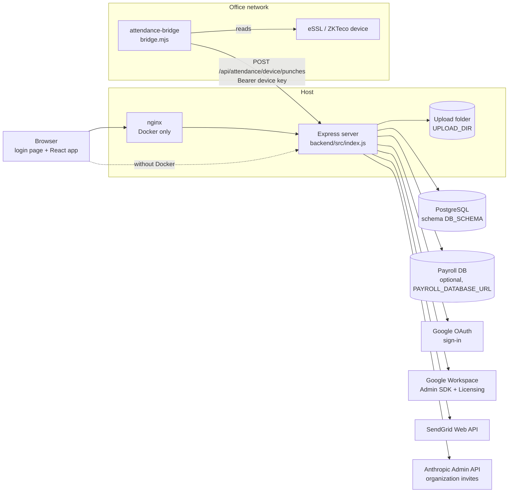

# Wohlig One — Architecture

> [!info] Read this first
> This is the map of the `hr-automation` repo, for people and LLMs. Read it before you open the code.
> The repo holds one Node server ([backend/](backend/)) and one React interface ([frontend/](frontend/)).
> There is no build step for the server and no ORM: routes run SQL directly through `pg`.
> The schema source of truth is [backend/src/schema.sql](backend/src/schema.sql), which the server applies on every start.
> Related docs: [[CLAUDE]] ([CLAUDE.md](CLAUDE.md), working rules) and [[BRAND_GUIDELINES]]
> ([docs/BRAND_GUIDELINES.md](docs/BRAND_GUIDELINES.md), Wohlig brand tokens). Read the brand file before any UI work.
> Also: [backend/docs/DEPLOY-CHECKLIST.md](backend/docs/DEPLOY-CHECKLIST.md), [backend/docs/PAYROLL.md](backend/docs/PAYROLL.md),
> [backend/attendance-bridge/README.md](backend/attendance-bridge/README.md).

## 1. Purpose

Wohlig One (formerly "HR Access Hub") is the staff portal for Wohlig (`@wohlig.com` accounts only). HR uses it to onboard and offboard people,
manage logins, approve leave, run payroll and review expense claims. Employees use it for their profile, documents, leave,
attendance, payslips, reimbursements, the company feed and their Digital Kit (signature, templates, greetings).

## 2. Tech stack

| Layer | What |
|---|---|
| Server | Node 22 (Docker image), ES modules, Express 4, `pg` 8, `dotenv` |
| Server libraries in use | `google-auth-library` (Workspace Admin SDK), `exceljs` (payroll Excel, tax import), `pdfkit` (payslip PDF) |
| Database | PostgreSQL (shared Cloud SQL in practice; `postgres:16` for the optional local container) |
| Interface | React 18, Vite 5, `react-router-dom` 6, plain CSS (no UI kit, no state library) |
| Email | SendGrid Web API over `fetch` |
| Office connector | Node 20+, `node-zklib`, Windows batch and VBS launchers |
| Tests | `node:test` plus two script-style flow tests |

`@anthropic-ai/sdk` and `nodemailer` are listed in [backend/package.json](backend/package.json) but no file imports them.

## 3. How it runs

### Local development

```
cd backend && cp .env.example .env    # fill in the values
npm install && npm run build:ui       # builds frontend/dist
npm run dev                           # node --watch src/index.js, http://localhost:3000
cd ../frontend && npm run dev         # optional: Vite on 5173, proxies /api, /auth, /invite to the server
```

Express serves everything on one origin: the API, `/login`, `/app/*` from `frontend/dist`, and the logos from `frontend/public`.
`frontend/dist` is committed, so the server works without a build.

### Docker

`docker compose up --build` gives `http://localhost:8080` ([docker-compose.yml](docker-compose.yml)).

| Service | Image | Job |
|---|---|---|
| `frontend` | [frontend/Dockerfile](frontend/Dockerfile), nginx 1.27 | Serves the built interface and `public/`; proxies `/api/`, `/auth/`, `/invite/`, `/l/`, `/p/` to the backend ([frontend/nginx.conf.template](frontend/nginx.conf.template)). Port 8080 to 80. |
| `backend` | [backend/Dockerfile](backend/Dockerfile), built from the repo root | The API on port 3000. Uploads live in the `hrhub-uploads` volume at `/srv/uploads`. |
| `db` | `postgres:16`, profile `local-db` only | A throwaway local database on 5432. |

In Docker, nginx decides who sees a page: it asks `GET /api/me` through `auth_request` and shows `/login` on a 401.

### Environment variable names

Values live in `backend/.env` (never committed). Names from [backend/.env.example](backend/.env.example):

- Core: `PORT`, `DATABASE_URL`, `DB_SCHEMA`, `SEED_ROSTER`, `BACKGROUND_JOBS`, `PUBLIC_URL`, `FRONTEND_URL`, `ALLOWED_EMAIL_DOMAIN`
- Accounts: `DEFAULT_PASSWORD`, `HR_ADMIN_EMAIL`, `HR_LEAVE_APPROVERS`, `ALLOW_PASSWORD_LOGIN`, `GOOGLE_OAUTH_CLIENT_ID`, `GOOGLE_OAUTH_CLIENT_SECRET`
- Google Workspace: `GOOGLE_SERVICE_ACCOUNT_FILE`, `GOOGLE_ADMIN_EMAIL`, `GOOGLE_SKU_STARTER`, `GOOGLE_SKU_BUSINESS`, `GOOGLE_PRODUCT_ID`
- Email: `SENDGRID_API_KEY`, `SENDGRID_EU`, `MAIL_FROM`, `MAIL_SKIP_RECIPIENTS`
- Reimbursements: `REIMB_REMINDER_DAYS`, `REIMB_NO_RECEIPT_MAX`, `OCR_PROVIDER`
- Claude access: `ANTHROPIC_ADMIN_KEY`, `ANTHROPIC_INVITE_ROLE`
- Attendance: `ATTENDANCE_DEVICE_KEY`, `PORTAL_ATTENDANCE_SYNC`, `PORTAL_ATTENDANCE_SYNC_SECONDS`
- Payroll: `PAYROLL_DATABASE_URL`, `PAYROLL_DB_SCHEMA`, `PAYROLL_REVIEWERS`, `PAYROLL_ENCRYPTION_KEY`, `PAYROLL_DEBIT_ACCOUNT`, `PAYROLL_DEBIT_BANK_CODE`, `PAYSLIP_AUTO`

The code also reads these, which the example file does not list: `UPLOAD_DIR`, `MAIL_REPLY_TO`, `EMAIL_LINK_MINUTES`,
`LEAVE_APPROVAL_LINK_HOURS`, `LEAVE_DIGEST_HOUR`, `LEAVE_DIGEST_SEND_EMPTY`, `LEAVE_DIGEST_EMAILS`, `LEAVE_HR_EMAILS`,
`CLAUDE_ADMIN_EMAILS`, `CLAUDE_REMIND_DAYS`, `PAYSLIP_AUTO_FROM`, `ANTHROPIC_API_URL` (test override).

The connector has its own file, [backend/attendance-bridge/.env.example](backend/attendance-bridge/.env.example):
`DEVICE_IP`, `DEVICE_PORT`, `DEVICE_NAME`, `APP_URL`, `DEVICE_KEY`, `INTERVAL_SECONDS`, `SYNC_FROM`.

Most integrations have a simulated mode when their settings are empty: Google Workspace, Claude access, email and device sync.

## 4. Runtime diagram



The Anthropic link is the Admin API called with `fetch` in [backend/src/anthropic.js](backend/src/anthropic.js): it invites
people to the Claude organization and removes them. The app does not call a Claude model anywhere.

## 5. Directory map

```
hr-automation/
├── docker-compose.yml          frontend (nginx) + backend + optional db
├── .claude/settings.json       shared Claude Code hook: checks this file at the end of each turn
├── docs/                       BRAND_GUIDELINES.md and the brand PDF
├── backend/
│   ├── src/                    the server: index.js plus one file per feature
│   │   ├── index.js            app set-up, route mounts, onboarding and project routes, background timers
│   │   ├── schema.sql          every table; applied on each start
│   │   └── payroll/            payroll workflow (routes, engine, tax, bank file, Excel, own schema.sql)
│   ├── migrations/hrhub-schema.sql   generated copy of schema.sql for a SQL console
│   ├── scripts/                one-off and operations scripts (migrate, imports, relay, check-architecture)
│   ├── seed/                   roster.json (first-run staff list) and digital-kit/ official files
│   ├── test/                   unit tests (*.test.mjs) and flow tests
│   ├── docs/                   DEPLOY-CHECKLIST.md, PAYROLL.md
│   └── attendance-bridge/      office connector for the attendance device (separate package)
└── frontend/
    ├── index.html, login.html  the two Vite entry pages
    ├── leave-rules.cjs         leave rules shared by server and browser
    ├── nginx.conf.template     nginx config for the Docker image
    ├── public/                 logos, favicons, sig/ icons; served at the site root
    ├── dist/                   committed build output
    └── src/                    App.jsx, pages/, modules/, components/, login/, lib/
```

## 6. Backend

### Layering

There are no controller, service or repository layers. Each feature file in [backend/src/](backend/src/) holds its routes,
its SQL and its helpers, and exports a router. [backend/src/index.js](backend/src/index.js) wires them together and also
holds the onboarding, roster, project and tool-access routes itself. [backend/src/db.js](backend/src/db.js) exports `pool`
(main database) and `payPool` (payroll database, the same pool unless `PAYROLL_DATABASE_URL` is set).

Mount order matters. The documents and Digital Kit routers are mounted before `express.json()` because they read raw file
bodies. The JSON body limit is 100 kb.

### Routers and modules

| File | Mount | Job |
|---|---|---|
| [users.js](backend/src/users.js) | `/api` (`sessionRouter`, `accountRouter`), `/api/users` | Password login (testing only), logout, invite acceptance, `/api/me`, HR user management |
| [google-signin.js](backend/src/google-signin.js) | `/auth` | Google OAuth code flow with PKCE |
| [invites.js](backend/src/invites.js) | `/invite` | One-time 30-minute invite links; also the in-memory rate limiter `tooMany` |
| [email-links.js](backend/src/email-links.js) | `/l` | Short-lived links used in automatic emails |
| [profile.js](backend/src/profile.js) | `/api/profile` | "My profile" sections and profile photo |
| [documents.js](backend/src/documents.js) | `/api/documents` | Personal document uploads; owns `UPLOAD_DIR` |
| [digital-kit.js](backend/src/digital-kit.js) | `/api/digital-kit` | Each person's kit; HR manages shared resources under `/admin` |
| [leave.js](backend/src/leave.js) | absolute `/api/leave/*`, `/api/employees/:email/pay` | Leave requests, decisions, comp offs, holidays, salary cuts |
| [leave-digest.js](backend/src/leave-digest.js) | `/api/leave/digest` | Daily "who is on leave" email to HR |
| [leave-mail.js](backend/src/leave-mail.js), [teams.js](backend/src/teams.js) | none | Leave emails; who approves whose leave |
| [attendance.js](backend/src/attendance.js) | `/api/attendance` | Today, month, day, report, manual punches |
| [device.js](backend/src/device.js) | `/api/attendance/device/*` | Punch intake from the connector; linking device IDs to people |
| [portal-attendance.js](backend/src/portal-attendance.js) | none (timer) | Copies punches from the Employee Portal's table when enabled |
| [assets.js](backend/src/assets.js) | `/api/assets` | Company assets; IT admins and HR |
| [posts.js](backend/src/posts.js) | `/api/posts` | Company feed: posts, images, likes, comments, shares |
| [celebrations.js](backend/src/celebrations.js) | `/api/celebrations`, `/p` | Birthday and welcome posters emailed by HR; public poster picture |
| [festivals.js](backend/src/festivals.js) | `/api/festivals` | Festival list and dates; share a greeting |
| [reimbursements.js](backend/src/reimbursements.js) | `/api/reimbursements` | Expense claims, receipts, review workflow; [extract.js](backend/src/extract.js) reads invoice PDFs |
| [budgets.js](backend/src/budgets.js) | `/api/budget-requests` | Pre-approved spending requests |
| [payroll/routes.js](backend/src/payroll/routes.js) | `/api/payroll` | Payroll runs, review workflow, bank details, tax rules, adjustments |
| [payslip-auto.js](backend/src/payslip-auto.js), [payroll.js](backend/src/payroll.js) | `/api/payroll` (HR only) | Automatic monthly draft, publish, salary structures, mark paid |
| [payslips.js](backend/src/payslips.js) | `/api/payslips` | A person's own payslips and PDF |
| [offboarding.js](backend/src/offboarding.js) | `/api/offboarding` | Offboarding records, steps, scheduled runs |
| [clearance.js](backend/src/clearance.js) | `/api/offboarding/.../clearance`, `/api/advances` | Final settlement figures and employee advances |
| [claude-requests.js](backend/src/claude-requests.js) | `/api/claude-requests` | Queue of Claude access requests when no admin key is set |
| [anthropic.js](backend/src/anthropic.js) | none | Anthropic Admin API calls and sync into `tool_access` |
| [google.js](backend/src/google.js), [mail-plan.js](backend/src/mail-plan.js) | none | Create Workspace users, assign licences |
| [notify.js](backend/src/notify.js) | `/api/notifications` | Bell notifications; `sendEmail` with outbox logging |
| [mail.js](backend/src/mail.js) | none | SendGrid call, `publicUrl()`, `frontendUrl()` |
| [connectors.js](backend/src/connectors.js) | none | Stand-in tool-removal connectors (nothing real is touched) |
| [validate.js](backend/src/validate.js), [employee-no.js](backend/src/employee-no.js), [sheet.js](backend/src/sheet.js), [payroll-calc.js](backend/src/payroll-calc.js) | none | Validation and masking, employee ID series, xlsx read and write, payslip maths |

Payroll internals in [backend/src/payroll/](backend/src/payroll/): `access.js` (who may see payroll, AES-256-GCM `seal`/`open`),
`workflow.js` (status machine), `engine.js`, `tax.js`, `tax-defaults.js`, `tax-import.js`, `bank.js`, `excel.js`,
`payslip-read.js`, `store.js`.

### Auth, sessions and roles

- Sign-in is Google OAuth at `/auth/google`. Password login works only when `ALLOW_PASSWORD_LOGIN=true`.
- A session is a random token in the `sid` cookie (HttpOnly, SameSite=Lax, 12 hours). Only its SHA-256 hash is stored in `sessions`.
- `loadSession` runs on every request and sets `req.user = { email, role, it_admin }`. `requireAuth` and `requireHr` live in [auth.js](backend/src/auth.js).
- `users.role` is `hr` or `employee`. Three more capabilities are derived, not roles:
  - IT admin: `users.it_admin` (HR counts too). Checked by `requireItAdmin` in [assets.js](backend/src/assets.js).
  - Payroll reviewer: an email listed in `PAYROLL_REVIEWERS` ([payroll/access.js](backend/src/payroll/access.js)).
  - Manager: anyone with people whose `employees.manager` is their name. Project leads manage their own projects.
- A first Google sign-in by someone on the staff list creates their `employee` login automatically.

### Main endpoints

All paths below were read from the code. Unless noted, a signed-in session is required.

| Area | Endpoints | Who |
|---|---|---|
| Session | `POST /api/login`, `POST /api/logout`, `GET /api/login-options`, `POST /api/auth/accept-invitation`, `POST /api/auth/resend-invitation` | Public |
| Sign-in | `GET /auth/google`, `GET /auth/google/callback`, `GET /invite/:token`, `GET /invite/:token/info`, `GET /l/:token` | Public |
| Account | `GET /api/me`, `POST /api/password` | Everyone |
| Users | `GET/POST /api/users`, `POST /api/users/bulk`, `POST /api/users/:email/invite`, `POST /api/users/:email/reset`, `PUT /api/users/:email/role`, `PUT /api/users/:email/it-admin`, `PUT /api/users/default-password`, `DELETE /api/users/:email` | HR |
| People | `GET /api/roster`, `GET /api/directory`, `GET /api/managers` | Everyone |
| People (HR) | `PUT /api/employees/manager`, `PUT /api/employees/number`, `PUT /api/employees/status`, `PUT /api/employees/:email/pay` | HR |
| Teams and projects | `POST /api/team/members`, `GET /api/allocations`, `POST /api/projects`, `PATCH /api/projects/:id`, `POST /api/projects/:id/members`, `POST /api/allocations/:id/end` | Managers, leads, HR |
| Onboarding | `GET/POST /api/onboarding`, `GET/PUT/DELETE /api/onboarding/draft`, `GET /api/onboarding/next-employee-no`, `POST /api/onboarding/work-email`, `GET /api/work-email` | HR |
| Offboarding | `GET/POST /api/offboarding`, `POST /api/offboarding/:id/run`, `/cancel`, `/steps/:key`, `/steps/:key/retry`, `/clearance/complete`, `GET /api/offboarding/:id/clearance`, `GET/POST /api/advances` | HR |
| Profile and documents | `GET/PUT /api/profile`, `PUT/GET/DELETE /api/profile/photo`, `GET /api/documents`, `PUT /api/documents/:docKey`, `GET /api/documents/:id/file` | Own data |
| Leave | `GET /api/leave`, `GET /api/leave/today`, `POST /api/leave/requests`, `POST /api/leave/requests/:id/decision`, `POST /api/leave/requests/:id/cancel`, `POST /api/leave/comp-off-requests`, `POST/PUT/DELETE /api/leave/holidays`, `GET /api/leave/salary-cuts` | Everyone; decisions by approver or HR |
| Attendance | `GET /api/attendance/today`, `/month`, `/day`, `/report`, `POST /api/attendance/punch`, `POST /api/attendance/punches` | Everyone; team data for managers and HR |
| Device | `POST /api/attendance/device/punches` (device key, no session), `GET/PUT /api/attendance/device/users` | Connector; HR |
| Reimbursements | `GET/POST /api/reimbursements`, `POST /from-document`, `PUT /:id/items/:itemId/document`, `POST /:id/submit`, `/approve`, `/reject`, `/request-changes`, `/resubmit`, `GET/PUT /categories` | Own claims; review by HR |
| Budgets | `GET/POST /api/budget-requests`, `POST /:id/approve`, `POST /:id/reject` | Own requests; decisions by HR |
| Payroll | `GET /api/payroll/overview`, `GET/POST /api/payroll/runs`, `POST /runs/:id/recalculate`, `POST /runs/:id/actions/:action`, `GET /runs/:id/files/:fileId`, `GET/PUT /bank/:email`, `GET/PUT /structures/:email`, `GET /tax-rules`, `GET/POST /adjustments`, `GET /audit` | HR and payroll reviewers |
| Payslips | `GET /api/payslips`, `GET /api/payslips/:period`, `GET /api/payslips/:period/pdf` | Own payslips |
| Tool access | `GET /api/tool-access`, `POST /api/tool-access/claude`, `POST /api/tool-access/claude/refresh`, `POST /api/tool-access/claude/confirm`, `GET /api/claude-requests` | HR; IT admins for the queue |
| Assets | `GET/POST /api/assets`, `PUT /api/assets/:id`, `POST /api/assets/:id/assign`, `POST /api/assets/:id/return` | IT admins, HR |
| Feed | `GET/POST /api/posts`, `PATCH/DELETE /api/posts/:id`, `PUT/DELETE /api/posts/:id/like`, `GET/POST /api/posts/:id/comments`, `POST /api/posts/images` | Everyone |
| Celebrations and festivals | `GET/POST /api/celebrations`, `POST /api/celebrations/:id/send`, `GET /p/:file` (public), `GET /api/festivals`, `POST /api/festivals/share` | HR; festivals for everyone |
| Digital Kit | `GET /api/digital-kit`, `GET /api/digital-kit/resources/:id/file`, `/api/digital-kit/admin/*` | Everyone; admin part HR |
| Other | `GET /api/notifications`, `POST /api/notifications/read`, `GET /api/audit` | Everyone; audit HR |

### Pages and static files served by Express

`GET /` and `GET /login` redirect signed-in people to `/app/dashboard`. `GET /app/*` sends `frontend/dist/index.html`, or
redirects to `/login` and remembers the page in the `hrhub_after` cookie for 15 minutes. `/app/assets` is the hashed build
output. A fixed list of logo and favicon files and `/sig` come from `frontend/public`. `/leave-rules.js` serves
[frontend/leave-rules.cjs](frontend/leave-rules.cjs).

### Background jobs

Timers in `index.js` (all skipped when `BACKGROUND_JOBS=off`): scheduled offboardings and invite expiry every minute; leave
digest every 10 minutes; reimbursement and budget reminders, automatic payroll draft, Claude request reminders and
celebration alerts every hour; optional Employee Portal attendance sync. They run in the server process, so two running
servers on one database would both run them.

## 7. Frontend

### Entries

| Page | Entry script | Served at | Content |
|---|---|---|---|
| [frontend/index.html](frontend/index.html) | [src/main.jsx](frontend/src/main.jsx) | `/app/*` | The app: `BrowserRouter` > `AuthProvider` > `ToastProvider` > `DataProvider` > `App` |
| [frontend/login.html](frontend/login.html) | [src/login-main.jsx](frontend/src/login-main.jsx) | `/login`, `/invite/<token>` | [login/Login.jsx](frontend/src/login/Login.jsx), or [login/Invite.jsx](frontend/src/login/Invite.jsx) when the path starts with `/invite/`; both use [login/AuthLayout.jsx](frontend/src/login/AuthLayout.jsx) |

Vite builds both with `base: "/app/"` and `publicDir: false` ([frontend/vite.config.js](frontend/vite.config.js)).
`index.html` loads `/leave-rules.js` before the app, which sets `window.LeaveRules`.

### Routing

Routes are in [frontend/src/App.jsx](frontend/src/App.jsx). Page routes are listed there; module routes are collected with
`import.meta.glob("./modules/*/index.jsx")`, each module exporting `routes`. Unknown paths go to `/app/dashboard`.

| Path | Component |
|---|---|
| `/app/dashboard` | `pages/Dashboard.jsx` |
| `/app/employees` | `pages/Employees.jsx` |
| `/app/employees/:email` | `modules/employee/EmployeePage.jsx` |
| `/app/allocations` | `pages/Allocations.jsx` |
| `/app/assets` | `pages/Assets.jsx` |
| `/app/attendance` | `pages/Attendance.jsx` |
| `/app/leave` | `pages/LeaveHr.jsx` |
| `/app/leave/apply` | `pages/LeaveApply.jsx` |
| `/app/leave/review/:id` | `pages/LeaveReview.jsx` |
| `/app/my-leave` | `pages/MyLeave.jsx` |
| `/app/team-leave` | `pages/TeamLeave.jsx` |
| `/app/payslips` | `pages/Payslips.jsx` |
| `/app/profile` | `pages/Profile.jsx` |
| `/app/account` | `pages/Account.jsx` |
| `/app/users` | `pages/Users.jsx` |
| `/app/audit` | `pages/Audit.jsx` |
| `/app/onboarding`, `/app/onboarding/progress` | `modules/onboarding/Onboarding.jsx`, `Progress.jsx` (HR only) |
| `/app/documents`, `/app/claude-requests` | `modules/onboarding/Documents.jsx`, `ClaudeRequests.jsx` |
| `/app/offboarding`, `/app/offboarding/leavers` | `modules/offboarding/Offboarding.jsx`, `Leavers.jsx` (HR only) |
| `/app/reimbursements`, `/new`, `/:id` | `modules/reimbursements/ReimbList.jsx`, `ClaimNew.jsx`, `ClaimDetail.jsx` |
| `/app/budgets`, `/new`, `/:id` | `modules/budgets/Budgets.jsx`, `BudgetNew.jsx`, `BudgetDetail.jsx` |
| `/app/payroll` | `modules/payroll/Payroll.jsx` |
| `/app/posts`, `/app/posts/:id` | `modules/posts/Posts.jsx` (`SinglePost`) |
| `/app/celebrations` | `modules/celebrations/Celebrations.jsx` (HR only) |
| `/app/festivals` | `modules/festivals/Festivals.jsx` |
| `/app/digital-kit` | `modules/digitalkit/DigitalKit.jsx` |

The "HR only" marks come from the `HR_ONLY` list in `App.jsx`. Every other page relies on the server refusing the request.

### Shared code

- [src/api.js](frontend/src/api.js): `api(method, url, body)` returns `{ ok, status, data }` and sends the browser to `/login` on 401.
- [src/auth.jsx](frontend/src/auth.jsx): `useAuth()` gives `user`, `isHr`, `itAdmin`, `isManager`, `payrollReviewer`.
- [src/data.jsx](frontend/src/data.jsx): `useData()` loads roster, tool access, documents, profile and leave once, with `reload()`.
- [src/components/](frontend/src/components/): `Shell.jsx` (top bar, menus, layout), `Modal`, `ConfirmDialog`, `DatePicker`, `Pager`,
  `PeoplePicker`, `PersonAvatar`, `PhotoEditor`, `OrgChart`, `NotificationBell`, `TodayCards`, `toast.jsx`, `ui.jsx`,
  `charts.jsx`, `leaveParts.jsx`, `leaveSummary.jsx`, `attendance.jsx`, `BackButton`, `BirthdayPopup`, `CelebrateCard`, `NextHolidayPopup`.
- [src/lib/](frontend/src/lib/): `leave.js` (re-exports `window.LeaveRules`), `useLeave.js`, `people.js`.
- [src/modules/](frontend/src/modules/): `budgets`, `celebrations`, `digitalkit`, `employee`, `festivals`, `offboarding`, `onboarding`, `payroll`, `posts`, `reimbursements`.

### Styling and theme

- [src/styles.css](frontend/src/styles.css) is the one stylesheet for the whole interface; both entries import it and no other CSS file exists. Its numbered sections: 1 brand tokens (`--brand-*`, `--btn-*`), 2 celebrations (`.cel-*`), 3 Digital Kit (`.dk-*`), 4 festival wishes (`.fw-*`), 5 birthday cards (`.bd-*`, `.cc-*`), 6 the signed-in app, 7 the sign-in and invitation pages (everything under `.auth`; `login.html` puts `auth-page` on `<body>`).
- Buttons are one standard, the wohlig.com button: `btn primary`, `btn glass`, with `lg`, `sm`, `block`. The rules are in [CLAUDE.md](CLAUDE.md) and [docs/BRAND_GUIDELINES.md](docs/BRAND_GUIDELINES.md).
- Sign-in components: [login/AuthLayout.jsx](frontend/src/login/AuthLayout.jsx) (shared layout), [login/PasswordField.jsx](frontend/src/login/PasswordField.jsx).
- Theme: [src/theme.js](frontend/src/theme.js) stores `light` or `dark` under `localStorage` key `hr_theme` and sets `data-theme` on `<html>`.
  With nothing stored it follows the system setting. The CSS answers both `:root[data-theme="dark"]` and `prefers-color-scheme`.

## 8. Data model

[backend/src/schema.sql](backend/src/schema.sql) defines 53 tables; [backend/src/payroll/schema.sql](backend/src/payroll/schema.sql) adds 6.
People are linked mostly by work email (text, compared in lower case), not by foreign key. `employees.manager` and
`projects.project_lead` hold a person's name.

| Table | Purpose | Key relations |
|---|---|---|
| `employees` | Everyone on staff; status `onboarding`, `active` or `offboarded`; masked ID numbers only | Hub of the model |
| `users`, `sessions`, `settings`, `invites` | Logins (`role`, `it_admin`), session hashes, default password, invite link hashes | `users.email` = `employees.work_email` |
| `onboarding_drafts` | One unsaved onboarding form per HR user | keyed by HR email |
| `audit_log` | Every recorded action (`action`, `work_email`, `ts`) | by email |
| `documents`, `profiles`, `profile_photos` | Uploaded documents, profile sections, photo | by email |
| `leave_requests`, `comp_off_credits`, `holidays` | Leave, comp-off credit, holiday calendar | by email |
| `projects`, `employee_project_allocations` | Projects and who works on them | FK to `employees`, `projects` |
| `attendance_punches`, `device_users`, `device_unmatched` | Punches, device ID links, punches waiting for a link | FK to `employees` |
| `offboardings`, `offboarding_steps`, `offboarding_clearances` | Offboarding record, its steps, confirmed settlements | steps and clearances FK to `offboardings` |
| `employee_advances`, `advance_recoveries` | Money paid ahead and what was recovered | recoveries FK to advances |
| `reimbursement_categories`, `reimbursements`, `reimbursement_items`, `reimbursement_documents`, `reimbursement_events` | Claim categories, claims, expense lines, receipts, timeline | items, documents, events FK to `reimbursements` |
| `budget_requests`, `budget_request_events` | Pre-approved budgets and their timeline | `reimbursements.budget_request_id` |
| `payroll_runs`, `payroll_items`, `salary_structures` | One run per month, one line per person (stores the whole slip), salary breakdowns | items FK to runs |
| `payroll_bank_accounts`, `tax_rules`, `tax_declarations`, `payroll_adjustments`, `payroll_files`, `payroll_audit` | Encrypted bank numbers, tax rules, declarations, arrears and recoveries, generated files, append-only trail | payroll schema file |
| `tool_access` | Which tools a person has and what the tool said | by email |
| `notifications`, `email_outbox`, `email_links` | Bell items, log of every email attempt, short-lived link hashes | by email |
| `posts`, `post_likes`, `post_comments`, `post_images`, `post_shares` | Company feed | FK to `posts` |
| `assets`, `asset_events` | Company assets and their history | `assigned_to` FK to `employees` |
| `celebrations`, `celebration_recipients`, `celebration_alerts` | Posters, delivery per recipient, alerts already sent | recipients FK to `celebrations` |
| `digital_kits`, `digital_kit_resources`, `digital_kit_state` | Per-person kit, shared resources, seeding flags | kits FK to `employees` |
| `festivals`, `festival_dates` | Festivals and their yearly dates | dates FK to `festivals` |
| `app_migrations` | Keys of one-time data fixes that already ran | none |

## 9. Cross-cutting concerns

- **Auth.** See section 6. Only `@wohlig.com` addresses can hold a login; a database check constraint enforces it as well.
- **Permissions.** Enforced on the server per router. The interface hides pages but is not the control.
- **Audit log.** Modules insert a plain sentence into `audit_log` after a change. Payroll has its own append-only `payroll_audit`.
- **Email.** `notify()` in [notify.js](backend/src/notify.js) writes a bell item and optionally emails. Every attempt lands in `email_outbox` as `sent`, `skipped` or `failed`. Without `SENDGRID_API_KEY` nothing is sent. `MAIL_SKIP_RECIPIENTS` blocks named addresses.
- **Uploads.** Files arrive as raw request bodies (`express.raw`), are type-checked from their first bytes, and are written to `UPLOAD_DIR` (default `backend/uploads`, ignored by Git). Table rows hold the stored file name. Digital Kit official files come from [backend/seed/digital-kit/](backend/seed/digital-kit/).
- **Sensitive data.** Aadhaar, PAN and account numbers are stored masked at onboarding. Payroll bank numbers and bank files are encrypted with `PAYROLL_ENCRYPTION_KEY`.
- **Migrations.** There is no migration tool. `initDb()` runs all of `schema.sql` on every start, so every statement is written to be repeatable (`CREATE TABLE IF NOT EXISTS`, `ADD COLUMN IF NOT EXISTS`, guarded `DO` blocks, `app_migrations` keys). `npm run migrate` does the same by hand, with `-- --dry-run`. `npm run migrate:sql` regenerates [backend/migrations/hrhub-schema.sql](backend/migrations/hrhub-schema.sql).
- **Tests.** Run from `backend/`:
  - `npm test` runs `test/*.test.mjs` (`leave-rules`, `payroll-calc`, `tax-import`, `architecture`). No database needed.
  - `npm run check:docs` runs [backend/scripts/check-architecture.mjs](backend/scripts/check-architecture.mjs): it fails when this file no longer names every server file, route mount, table, `.env.example` variable, page, module and component, or when the docs link to a missing file. The `architecture` test runs the same check, and a Claude Code Stop hook in [.claude/settings.json](.claude/settings.json) runs it at the end of each Claude turn.
  - `npm run test:invites` and `npm run test:device` start a throwaway server and use the database in `DATABASE_URL`; they create and remove temporary rows.
  - The frontend has no tests and no lint script.

## 10. Conventions seen in the code

- ES modules everywhere; the one CommonJS/UMD file is `frontend/leave-rules.cjs`, imported by the server as `../../frontend/leave-rules.cjs`.
- Async route handlers are wrapped with `wrap(fn)` so a thrown error becomes a JSON 500. Errors are `{ error }`; form errors are `{ errors: { field } }`.
- SQL is parameterised (`$1`, `$2`). Emails are compared with `lower(...)`. Multi-step writes use `BEGIN`/`COMMIT` on a pooled client.
- DATE columns come back as `YYYY-MM-DD` strings (type parser in `db.js`). "Today" is India time.
- Database columns are snake_case; JSON sent to the browser is camelCase, mapped by hand in each route.
- User-facing messages are full plain sentences. Comments explain why, in the same style.
- New frontend features go in `src/modules/<name>/index.jsx` and export `routes`; nothing else needs registering.
- Data-copy scripts in [backend/scripts/](backend/scripts/) default to a dry run and write only with a flag such as `--apply`. `migrate.mjs` is the exception: it writes unless given `--dry-run`.

## 11. Known gaps and risks

- **`migrations/hrhub-schema.sql` is stale.** It has 530 lines against 779 in `src/schema.sql` and lacks later tables (for example `salary_structures`, `email_links`, `device_users`, `posts`, `assets`, `celebrations`, `digital_kits`, `festivals`). Regenerate it with `npm run migrate:sql` before using it.
- **`frontend/dist` is committed.** A source change without `npm run build:ui` leaves the non-Docker server on the old interface.
- **Two servers decide page access.** Express does it without Docker; nginx does it in Docker. A new public path (like `/l/` or `/p/`) must be added to both `index.js` and `nginx.conf.template`.
- **`index.js` is 706 lines** and mixes set-up with onboarding, project and tool-access routes.
- **Name-based links.** Managers and project leads are matched by name, so a rename or two people with the same name breaks reporting lines.
- **In-memory limits.** Login lockout and `tooMany` rate limits live in process memory: they reset on restart and are not shared between instances. Some key on `req.ip`, and Express `trust proxy` is not set, so behind nginx all callers share one address.
- **No CSRF token, `helmet` or CORS set-up.** Protection rests on the SameSite=Lax cookie and same-origin serving.
- **Unused dependencies:** `@anthropic-ai/sdk`, `nodemailer`.
- **Stale wording:** two start-up errors in `auth.js` say `server/.env` and `.gitignore` names `hr-automation/server/data/` (the folder is now `backend/`); `Shell.jsx` and `documents.js` comments mention an older single-page app that is no longer in the repo.
- **Vite dev proxy is partial.** It forwards `/api`, `/auth`, `/invite`, the leave rules and some logo files, but not `/sig`, `/l` or `/p`.
- **Defaults in code:** `MAIL_SKIP_RECIPIENTS` and `PAYROLL_REVIEWERS` fall back to named addresses when unset.
- **`users`, `sessions` and `settings` are each declared twice** in `schema.sql`; harmless, but confusing.
