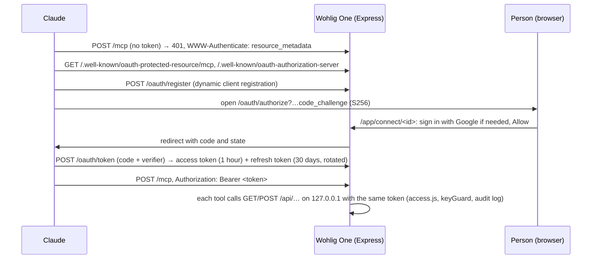

# Wohlig One connector for Claude

> [!info] Read this first
> The connector lets Claude do the work of the Wohlig One HR dashboard for anyone at Wohlig, as that person: see who is on leave,
> approve leave and attendance corrections, follow onboarding, hiring, probation and the helpdesk, post announcements, run reports.
> It can do exactly what the person can do in the browser and nothing more. Map of the code: [ARCHITECTURE.md](../ARCHITECTURE.md).

## Connect it (staff)

1. In Claude (claude.ai, Claude Desktop or Claude Code), open **Settings > Connectors > Add custom connector**.
2. Name it Wohlig One and paste the address shown on **Wohlig One > Account > Access keys for Claude** (the portal's address
   followed by `/mcp`).
3. Choose **Connect**. Wohlig One opens: sign in with your @wohlig.com Google account if asked, read what Claude may and may not
   do, and choose **Allow**.

A Claude organisation admin can add the connector once for everyone; each person still connects and allows it for themselves.
To end it, choose **Disconnect** under Connected apps on the Account page. Changing or resetting your password ends every
connection and access key.

Claude Code can also connect from a terminal: `claude mcp add --transport http wohlig-one https://<portal>/mcp`, then `/mcp` to sign in.

## What it will never do

Whatever the connector reads is handed to an AI assistant, so the server refuses these to every connection, even a salary owner's
(`backend/src/access-keys-rules.js`, and `salaryRule` in `access-rules.js`):

- salaries, payslips, payroll, finance reports, tax, expense claims, loans, budgets, advances, offer letters, final settlements
- staff documents, the document password, PAN and Aadhaar numbers (full or masked), bank accounts, IFSC and PF numbers: these
  fields are removed from every answer the connector gets, whatever the page, so a new page cannot leak them by accident
- access rights, logins and passwords (it can read the Users list, not change it), passkeys, access keys and connections
- punching in or out for yourself

Every change made through the connector is in the audit log as `… through the access key "<app> (connector)"`, and refused
attempts are logged too.

## The tools

| Area | Tools |
|---|---|
| Home | `wohlig_whoami`, `wohlig_dashboard`, `wohlig_notifications`, `wohlig_mark_notifications_read` (change) |
| To do | `wohlig_todo`: pending leave, attendance requests, timesheets, interviews and open tickets |
| People | `wohlig_list_employees`, `wohlig_get_employee`, `wohlig_managers`, `wohlig_set_manager` (change), `wohlig_allocations` |
| Leave | `wohlig_leave`, `wohlig_leave_today`, `wohlig_leave_policy`, `wohlig_apply_leave`, `wohlig_decide_leave`, `wohlig_cancel_leave` (changes) |
| Attendance | `wohlig_attendance_day`, `wohlig_attendance_month`, `wohlig_attendance_report`, `wohlig_add_punch` (change, for someone else, with a reason), `wohlig_attendance_requests`, `wohlig_decide_attendance_request` (change) |
| Timesheets | `wohlig_timesheets_to_approve`, `wohlig_decide_timesheet` (change) |
| Joiners and leavers | `wohlig_onboarding`, `wohlig_offboarding`, `wohlig_notice_periods` |
| Hiring | `wohlig_openings`, `wohlig_candidates`, `wohlig_interviews` |
| Probation and reviews | `wohlig_probations`, `wohlig_decide_probation` (change), `wohlig_review_cycles`, `wohlig_reviews`, `wohlig_exit_interviews` |
| Helpdesk | `wohlig_tickets`, `wohlig_ticket`, `wohlig_reply_ticket`, `wohlig_close_ticket` (changes) |
| Community | `wohlig_announcements`, `wohlig_post_announcement` (change) |
| Manage | `wohlig_assets`, `wohlig_shifts`, `wohlig_overtime`, `wohlig_report_builder`, `wohlig_run_report`, `wohlig_users`, `wohlig_audit_log` |
| Everything else | `wohlig_list_endpoints`, `wohlig_api_get`, `wohlig_api_call` (change) |

## How it works (developers)

- **Tokens are access keys.** An access token is a row in `access_keys` with `kind = 'oauth'` and a `grant_id`; `loadSession` signs
  it in like any key (`req.access.viaKey`), so the salary rule, `keyGuard` and the audit log apply without new code. Only hashes
  are stored. `oauth_grants` holds each connection (its refresh token's hash), `oauth_requests` a sign-in in progress (10 minutes),
  `oauth_clients` the registered apps.
- **Allowing needs a sign-in from the last 30 minutes**, as making an access key does.
- **Only Claude can receive the code.** An app may register return addresses only on claude.ai, claude.com (or hosts named in
  `CONNECTOR_REDIRECT_HOSTS`) or http on localhost, so a look-alike page cannot collect a code. The Allow page names the app and
  shows where it returns in large type.
- **Short codes, rotating refresh tokens.** A code lasts 60 seconds and works once; a second use ends the connection it made. Each
  refresh swaps the refresh token; presenting an old one again ends the connection. Every connection ends after 90 days.
- **Files:** `backend/src/oauth.js` and `oauth-rules.js` (sign-in), `mcp-server.js` (the `/mcp` endpoint, MCP TypeScript SDK v2
  with `createMcpHandler`, no sessions), `mcp/tools.js` (the tools), `mcp/catalog.js` (endpoint list read from the route files),
  `frontend/src/modules/connect/` (the Allow page), `components/AccessKeys.jsx` (Account card). nginx sends `/mcp`, `/oauth/` and
  `/.well-known/oauth-*` to the backend.
- **Tests:** `node --test test/oauth.test.mjs test/access-keys.test.mjs` (in `npm test`), and against a local server
  `test/oauth-flow.mjs` and `test/access-keys-flow.mjs` (see their headers).
